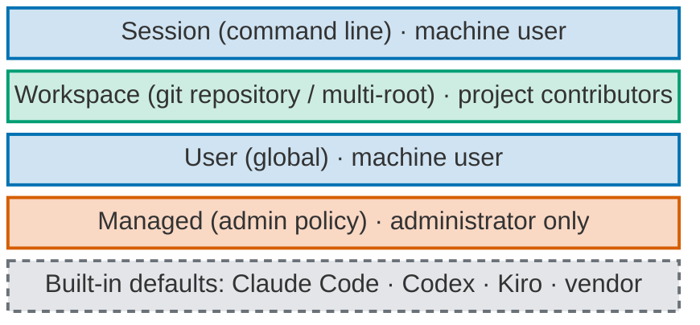
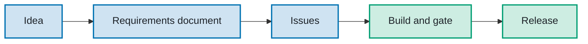

# personal-multi-harness-workstation-configuration

The managed workstation: one versioned source for how every agent harness (Claude Code, Codex and
Kiro) behaves on the owner's devices. One release installs the same protection, standards and working
method into every agent harness, on any of his machines.

This page is the short version. The target behaviour and the reasons for it are in the
[Product Requirements Document](docs/mhw-product-requirements-document-project.md).
The mission, principles and hard rules for agents working here are in [`AGENTS.md`](AGENTS.md).

## Why it exists

Work done with AI agents must respect other people: clients' and employers' confidential material,
third parties' commercial rights and intellectual property, and everyone's personal data. Only the
owner's own knowledge and learning is his. This repository is the protection layer that keeps that line
for every agent at once, and stops credential reads, irreversible commands and unsafe actions while the
agents run. It is also a rehearsal, on one person's workstations, of what a company would roll out to
its engineers.

The command-line agent harnesses come first: they are fast, tile well, scale to many parallel sessions,
and keep configuration in files that can be versioned, tested in CI and installed by one command.
Running the same behaviour on three agent harnesses protects against any one vendor's cost changes,
feature changes and outages.

## Four layers



*Read bottom-up. Grey dashed: vendor. Orange: administrator only. Blue: machine user. Green: project
contributors.*

- **Managed:** a thin protection core that no agent can switch off, because changing it needs `sudo` and
  `sudo` is denied to agents.
- **User:** the global brief, the owner overlay, interaction standards and the working method (agents,
  skills, commands), rendered into each agent harness's native mechanism.
- **Workspace:** only what one project needs, plus a version key that names the workstation release
  range it expects.
- The `tadeumendonca-skills` plugin is a generated copy of the method, never a source and never a
  protection, and nobody installs it once #130 removes it from the workstation (#63). Method demands
  start here as Issues labelled `method`; the sync mirrors them there (#62).

Hard locks are kept for irreversible or third-party harm only. Everything else is taught through
instructions, native settings and automatic cleaning, and reported at its real evidence level.

## Workflow



*Read left to right. Blue: the owner decides. Green: the agents carry the work to the end.*

## Current state

The single record of what each control reaches, per agent harness surface and operating system, at
its real evidence level. It replaces the amendment log that `AGENTS.md` used to carry (Issue
[#65](https://github.com/tedeuxx/mhw/issues/65)); that log
stays in the git history.

**Two claims per row, never mixed.** The agent harness columns describe **this source** (the
`rc/next` release candidate, before its next release tag). The last column describes **the owner's reference
machine** (macOS), from the last recorded install, and is not re-measured unless it says so.
The reference machine currently has **mixed layers** (observed 2026-10-18): the user layer is
installed from this release candidate at `086a74aa1b2c960012e1ecb4b80981ca04ca8501`, while the admin
layer remains at v5.8.0 (`8c4cec8a6aebfa2376e3333ef78ecdf543f480b0`). `mhw status` observes
installation only; loading and enforcement still require their named fresh-session canaries. This
snapshot supersedes older blanket `not installed` wording in individual rows for user-layer
artifacts, while those rows retain the last control-specific load/enforcement measurement.

| Word | Meaning |
| --- | --- |
| *written* | in the source and covered by the CI suites (Ubuntu and macOS; Windows where `install.ps1` is named) |
| *probed* | installed into a throwaway home on the named version and observed there: *loaded* (the agent harness lists or shows it) or *enforced* (it refused or cleaned on a synthetic input). Never on the owner's machine |
| *documented* | vendor documentation only; not exercised |
| *none* | the agent harness has no carrier for it; the gap is stated, not filled by a hook |
| *installed*, *loaded*, *enforced* | in the last column only: measured on the reference machine |

| Control | Claude Code (CLI) | Codex (CLI) | Kiro (CLI, IDE) | Claude and ChatGPT desktop | OS | Reference machine (last recorded) |
| --- | --- | --- | --- | --- | --- | --- |
| Global brief, with the version key, runtime summary and session goal anchor ([ADR-0010](docs/adr/0010-global-brief-rendered-to-each-harness.md)) | written; loaded, probed (2.1.286) | written; loaded, probed (0.160.0): the goal anchor is in the model-visible prompt | written; documented | pasted by hand; instruction only | macOS, Linux, Windows | an earlier brief *installed*, *loaded* in Claude Code and Codex (2026-10-01). The RC sections are not installed. An instruction, never *enforced* |
| Interaction standards: one question per message, three options, Portuguese with the owner ([ADR-0019](docs/adr/0019-paced-conversation-and-three-path-decisions.md), [ADR-0013](docs/adr/0013-hitl-escalation-calibration.md)) | written, in the brief; instruction only | same | same | pasted by hand | macOS, Linux, Windows | the earlier wording *installed*; its picker guard hook still runs until the owner reinstalls both layers |
| Deny floor, user layer ([ADR-0016](docs/adr/0016-user-level-deny-floor-rendered-per-harness.md)) | written; enforced, probed. A prefix floor; `--setting-sources project` drops it (measured) | written; enforced, probed (`execpolicy`); `--ignore-rules` skips it (help text) | written and tested ([ADR-0036](docs/adr/0036-kiro-shared-deny-floor-permissions-yaml.md)): merged into `~/.kiro/settings/permissions.yaml`, which Kiro IDE and Kiro CLI V3 read (documented); the owner's rules kept, 0600 backup. Not read by Kiro CLI 2.x, the default engine, which sessions through the paste wrapper run on; its own carrier (`toolsSettings.deniedCommands` and `deniedPaths` in a CLI agent) is documented and not rendered. Not enforced-measured. On Windows `install.ps1` renders it too (CI-tested; Kiro on Windows not measured) | none | macOS, Linux, Windows | 101 rules *installed* (2026-10-01, per `install.sh --check` on that machine); not re-measured. The RC's floor is not installed: 206 Claude Code rules and 182 Codex rules with the overlay, 185 and 161 without (2026-10-10, ADR-0035; the gap is the file and glob entries Codex cannot carry), read from the `FLOOR` lines of `global/install.sh --check` (and `--overlay=none`) in a throwaway HOME |
| Deny floor, admin layer ([ADR-0016](docs/adr/0016-user-level-deny-floor-rendered-per-harness.md), 2026-10-05 amendment) | written; the managed carrier probed (a managed hook ran, 2.1.289); the deny itself documented | written; `requirements.toml` documented | written and tested in a throwaway root ([ADR-0036](docs/adr/0036-kiro-shared-deny-floor-permissions-yaml.md), 2026-10-11 amendment): the floor as deny rules in the root-owned `managed-settings.json`, which Kiro IDE 1.2.56 and the Kiro CLI V3 engine read as their `administration` scope (read from both bundles; not measured); the user `permissions.yaml` stays as the fallback. Kiro CLI 2.x does not read it. Not on Windows | documented for the Claude Code tab | macOS, Linux | not installed: the owner's `sudo` act ([runbook](docs/runbooks/deny-floor-admin-layer.md)) |
| Paste wrapper, the primary cleaner ([ADR-0033](docs/adr/0033-paste-cleaning-wrapper-primary-hook-safety-net.md)) | written; enforced, probed (2.1.289): a synthetic paste arrives redacted | written; enforced, probed (0.160.0) | wraps `kiro-cli`. On the V3 engine it cleans **nothing**: Kiro CLI 2.29.1 with `--agent-engine v3` does not enable bracketed paste, so the wrapper warns that pastes are not cleaned (observed on the reference machine, 2026-10-11; [ADR-0033](docs/adr/0033-paste-cleaning-wrapper-primary-hook-safety-net.md) amendment). 2.x engine not measured. IDE: none | none | macOS, Linux | an earlier wrapper active in the owner's shell (observed 2026-10-05); the marker logic is not installed. Since [#145](https://github.com/tedeuxx/mhw/issues/145) install writes the activating block into `~/.zshrc` (zsh) or `~/.bashrc` (bash, plus on macOS the login file `~/.bash_profile`) itself, with a backup, and uninstall removes exactly that block: written and tested in throwaway homes; not installed |
| Paste prompt hook, the safety net ([ADR-0033](docs/adr/0033-paste-cleaning-wrapper-primary-hook-safety-net.md), [ADR-0025](docs/adr/0025-hook-layers-in-the-native-admin-layer.md)) | written; enforced, probed (2.1.289): blocks without the wrapper's marker, passes with it | written; enforced, probed (0.160.0); runs only after the owner trusts it in `/hooks` | none | none | macOS, Linux | *installed* in the admin layer (v2.1.0); *enforced* on Claude Code (2026-10-04). That copy predates the marker, so it still blocks wrapped sessions |
| Pre-authorisation allow list ([ADR-0031](docs/adr/0031-pre-authorisation-allow-list-behind-the-admin-floor.md)) | written; the permission mode loaded, probed. Wide tier only behind the admin floor. Its `Edit` deny covers only the checkout that ran the installer | written; rules loaded, probed; decisions measured with `execpolicy check` | written, narrow tier; documented. Since 2026-10-11 the agent carries the 2.0 fields and the V3 `permissions` form, so Kiro CLI no longer asks to `/upgrade-agent` (read from the bundled V3 engine; not run). The IDE then loads the agent too ([ADR-0036](docs/adr/0036-kiro-shared-deny-floor-permissions-yaml.md) amendment) | none | macOS, Linux | not installed. Since [#145](https://github.com/tedeuxx/mhw/issues/145) install also removes the user-level `Bash(find:*)` and `Bash(awk:*)` (ADR-0035 decision 4; also the `Bash(x *)` and `Bash(x*)` spellings, per the Claude Code permissions documentation; the bare forms stay) from `~/.claude/settings.json`, with a backup: written and tested in throwaway homes; not installed |
| Working method: 8 agents, 19 skills, 7 commands ([ADR-0032](docs/adr/0032-this-repository-is-the-single-source-of-the-working-method.md)) | written; loaded, probed (2.1.289), each agent's tool list applied | written; skills loaded, probed (0.160.0), commands kept out of implicit use; agents documented, with no tool list | written; documented (agents and skills; commands as skills) | Claude Code tab documented; otherwise none | macOS, Linux, Windows (`install.ps1 -Method`, CI) | not installed: the plugin is still the running copy until #130 removes it (#63). ~~Since #130, `--method` also retires the plugin at user scope (Claude Code settings, install records and marketplace; Codex `config.toml`), with a 0600 backup that uninstall restores from; project scopes are reported, not touched. Written and tested in throwaway homes; not run on the reference machine;~~ *Removed in v7 ([#206](https://github.com/tedeuxx/mhw/issues/206)):* install no longer edits the plugin, and uninstall no longer restores one; a plugin still enabled is named by `mhw status` and disabled with the agent harness's own command. The owner's steps are in the [cutover runbook](docs/runbooks/method-cutover.md) |
| Method backlog sync: an mhw Issue labelled `method` mirrored as an adapted twin Issue in `tadeumendonca-skills` ([#62](https://github.com/tedeuxx/mhw/issues/62), [ADR-0032](docs/adr/0032-this-repository-is-the-single-source-of-the-working-method.md) 2026-10-12 amendment) | not an agent harness control: a CI workflow running `anthropics/claude-code-action` | | | | any (CI) | written and tested (the workflow's structure and its sync script, against a stub `gh`). **Works end to end on `main`, measured** (canary 4, 2026-10-12, v5.5.3): run 38324740491 created the twin tadeumendonca-skills#564 and linked it, run 38324871241 closed it, `verify` passed both times. Before that it failed three times before any write to tadeumendonca-skills: run 38269161317 (bubblewrap missing; fixed by [#163](https://github.com/tedeuxx/mhw/pull/163), its isolation then worked on the runner), run 38294048591 (most likely the env scrub dropping the token names: measured on Claude Code 2.1.296 on macOS, inferred on the runner; fixed by [#165](https://github.com/tedeuxx/mhw/pull/165), the inputs then reached the script) and run 38307434605 (the Write tool denied the body file, observed; the cause, a `Write(path)` rule that file permission checks ignore, measured on Claude Code 2.1.296 on macOS, inferred on the runner). The fix ([#167](https://github.com/tedeuxx/mhw/pull/167)) is what canary 4 ran ([runbook](docs/runbooks/method-issue-sync.md)). The secrets are stored (2026-10-12); it runs only from `main`. Without its secrets it skips with a notice |
| Session-start model and effort, pinned by ID ([ADR-0035](docs/adr/0035-workstation-blueprint-reconciliation.md) slice B, [ADR-0007](docs/adr/0007-session-start-model-and-effort-defaults.md)) | written: `model`, `effortLevel` in the user settings; not checked in a new session. A workspace or environment value wins | written: `model`, `model_reasoning_effort`; not checked in a new session. A profile or `-m` wins | Kiro CLI written: `chat.defaultModel`, no effort; the model list measured (2.29.0). IDE: none | the Claude Code tab shares the user settings (documented); otherwise none | macOS, Linux | not installed. ~~The owner's own Claude Code `model` and Codex `model_reasoning_effort` are kept until he deletes them~~ Since [#145](https://github.com/tedeuxx/mhw/issues/145) install writes the pin over any value, reports old -> new, and uninstall restores the value it replaced: written and tested in throwaway homes |
| Codex descriptor-limit configuration review ([ADR-0039](docs/adr/0039-codex-managed-daemon-version-and-headroom.md), [#200](https://github.com/tedeuxx/mhw/issues/200)) | not touched | review evidence only: no permanent FD/process monitor, daemon probe, alignment check or install-time update/restart is part of `mhw`. No supported native Codex setting for the managed daemon's descriptor limit was found. No global or process limit, hook, paste wrapper or native daemon configuration is changed | not touched | none | macOS | measured 2026-10-19: Codex CLI, managed package and app-server are aligned at 0.163.0; Codex Doctor's installation, configuration and persistent app-server checks are healthy; the current session soft descriptor limit is 4096 while the launchd default is 256. These are bounded observations, not continuous monitoring or enforcement |
| Retired MCP server `aws-api` ([ADR-0035](docs/adr/0035-workstation-blueprint-reconciliation.md) decision 2, [#145](https://github.com/tedeuxx/mhw/issues/145)) | not touched | ~~written: `mhw install` removes the `aws-api` server (its table and sub-tables), as listed in `global/mcp/retired-servers.conf`, from `~/.codex/config.toml` (or `$CODEX_HOME/config.toml`); the edit is verified with tomllib and no server value is printed. The previous file is kept as `config.toml.pmhwc-mcp-backup`, owner-only (0600), which is the restore route; uninstall does not re-add the server~~ *Removed in v7 ([#206](https://github.com/tedeuxx/mhw/issues/206)):* install no longer edits the Codex configuration for it. An `aws-api` table still there is removed by hand; a `config.toml.pmhwc-mcp-backup` an earlier install left stays the restore route | not touched | none | macOS, Linux | ~~not installed. Written and tested in throwaway homes~~ the reference machine's Codex configuration carries no `aws-api` entry (the owner's read-only check on #206, 2026-10-18) |
| Browser MCP server `chrome-devtools`, bounded by origin ([ADR-0038](docs/adr/0038-chrome-devtools-mcp-at-user-scope-bounded-by-origin.md), [#174](https://github.com/tedeuxx/mhw/issues/174)) | written: `mhw install` writes it into the user configuration (`~/.claude.json`) from `global/mcp/policy-servers.json`, prints old -> new, keeps `~/.claude.json.pmhwc-mcp-policy-backup` (0600); uninstall removes it. `chrome-devtools-mcp@1.8.0` through `npx --ignore-scripts`; its shell reads `HARNESS_SWEEP_ORIGIN` when the server starts, else (unset, empty or not `http(s)://`) the discard port `http://127.0.0.1:9/*`. Measured on 2.1.296 in throwaway homes: a project's settings `env` reaches the server's environment but not a `${VAR}` in its arguments, so the launch-time read is what carries it. ~~Not loaded, not enforced: that needs a fresh session and the canary in ADR-0038~~ Canary on 2026-10-15 ([#174](https://github.com/tedeuxx/mhw/issues/174#issuecomment-6202067041), 2.1.301 in tadeumendonca-io): loaded, because the tools are listed and the server process carries the bound; enforced for the origin bound, because `product-lead` reached the declared origin and example.com was refused. The error text does not name the flag, so attributing the refusal to `--allowedUrlPattern` is inference. Not measured: the persona's tool exclusions, and which of the host's servers the session owns | ~~not rendered (a declared gap)~~ written and tested: since 2026-10-26 the owner's local MCP definition may extend it here ([ADR-0038](docs/adr/0038-chrome-devtools-mcp-at-user-scope-bounded-by-origin.md) amendment); not measured | ~~not rendered (a declared gap)~~ written and tested, the same way; not measured | ~~none~~ Claude desktop: written and tested, the same way; not measured. ChatGPT desktop: none | macOS, Linux | ~~not installed. Written and tested in throwaway homes~~ installed on the reference machine (workstation v5.7.0, per the canary); written and tested in throwaway homes |
| Outbound scan, `mhw scan` and the `outbound-scan` CI check ([ADR-0035](docs/adr/0035-workstation-blueprint-reconciliation.md) decision 7) | not an agent harness control | | | | macOS, Linux | not installed. Written and tested; the CI job runs on every pull request; findings never block; employer and client terms are not checked on the runner; no install-time component |
| Provenance stamp ([ADR-0029](docs/adr/0029-provenance-stamp-in-every-installed-file.md)) | written; stamped files loaded, probed | written; loaded, probed | written; documented | none | macOS, Linux, Windows (CI) | not installed. A record, not a protection |
| `./mhw` (formerly `./mhw`), version key, `status` and `check` ([ADR-0030](docs/adr/0030-version-key-and-one-entry-point.md)) | written; the version-key instruction in the loaded brief, probed | written; in the model-visible prompt, probed | written; documented | none | macOS, Linux | not run. A report, never a block |
| npm install from GitHub by tag, `mhw` command and its `postinstall` ([ADR-0034](docs/adr/0034-npm-distribution-from-github-by-tag.md)) | not an agent harness control | | | | macOS, Linux, Windows (CI) | written. Probed in throwaway prefixes and HOMEs from GitHub at the branch head (npm 11.13.0, macOS): the postinstall installed the stamped user layer and printed the sudo line; upgrade from v4.1.0, a local install and `npm uninstall -g` measured; not installed on the reference machine. Since [#113](https://github.com/tedeuxx/mhw/issues/113) the postinstall installs nothing and `mhw install` is the one door (RETURN, the password once, next steps): tested in throwaway prefixes, HOMEs and admin roots, and in a pty; the real `sudo` prompt is not exercised by any test |
| Prerequisites check, check-only ([#89](https://github.com/tedeuxx/mhw/issues/89)) | not an agent harness control | | | | macOS, Linux | written and tested with fake tools; one read-only run of `gh auth status` and the merge-settings check. Applies nothing |
| GitHub repository standard: merge commits only, no squash ([#82](https://github.com/tedeuxx/mhw/issues/82)) | not an agent harness control | | | | any | ~~written and tested against a stub; `--apply` is the owner's act~~ *Since [#206](https://github.com/tedeuxx/mhw/issues/206):* `mhw check` reads it with `gh repo view --json mergeCommitAllowed,squashMergeAllowed,rebaseMergeAllowed` (written and tested against a stub gh); applying it is the owner's `gh repo edit OWNER/REPO --enable-merge-commit --enable-squash-merge=false --enable-rebase-merge=false` |
| MCP active set: servers outside the local definition turned off ([ADR-0041](docs/adr/0041-mcp-active-set-native-switch-off-per-harness.md), [#219](https://github.com/tedeuxx/mhw/issues/219)) | written: once the local definition declares `active_set`, `mhw install` appends a `deniedMcpServers` entry to `~/.claude/settings.json` for each server outside it: `serverName` for a `~/.claude.json` server and for a claude.ai connector declared `off`, `serverUrl` or `serverCommand` for a plugin server (installed and synced plugins). The switch is documented, not probed. A plugin server whose launch line carries `${...}`, or whose command or URL host equals a server kept on, is reported, not denied (a deny would block the kept one too); connectors are declared by hand and cannot be read locally | written: `enabled = false` on the server's table in `config.toml`, verified with tomllib; probed (0.163.0): `codex mcp list` shows it disabled | written: `"disabled": true` in `~/.kiro/settings/mcp.json`; documented, not probed (the CLI needs a login) | Claude desktop: report only, no per-server switch | macOS, Linux | not installed. Written and tested in throwaway homes: undeclared turns nothing off; uninstall turns back on only what install turned off (Codex byte for byte); exempt: `node_repl`, `claude-in-chrome`; `mhw status` names what is on outside the set and what is missing, by name and count, and says `not read` for an agent harness it could not read; `mhw status --mcp-connect` (opt-in, never in the default view) starts each set member as each agent harness has it and prints name and result (`ok`, `needs login`, `fail: ...`), never stderr or a body; written and tested against synthetic stubs, not run on the reference machine |
| MCP definition ([ADR-0017](docs/adr/0017-single-source-mcp-with-secret-indirection.md)) | written | written | written | written (Claude desktop) | macOS | not run. Not part of the main line |
| Removed from the source: restart guard, expiring switches, `/breaking-glass`, picker guard, session-type intake ([ADR-0028](docs/adr/0028-remove-restart-guard-and-expiring-switches-os-privilege-only.md)) | written: the installers delete what an earlier version wrote; `--check` reports it as `STALE` | same | none was installed | none | macOS, Linux | still *installed* until the owner reinstalls both layers in a fresh session |

Outside mechanical reach, on every row: the desktop apps' chat surfaces, Windows beyond the brief, the
deny floor, the method and the #145 install steps, files read by path, pasted images, and sessions not started through the
wrapper. Every protection that is an instruction is best effort: whether a model follows it is not
measured.

## Install

New machine: start with [Install on another workstation](docs/new-workstation.md), which previews the
controls without inheriting the reference owner's overlay.

**With npm, from GitHub by tag** ([ADR-0034](docs/adr/0034-npm-distribution-from-github-by-tag.md),
[runbook](docs/runbooks/npm-install.md)). Nothing is published to the npm registry. You need Node.js 18
or later and git; on macOS and Linux also Python 3.9+ and `jq`. The package and its command are `mhw`
(multi-harness managed workstation):

```sh
npm install -g github:tedeuxx/mhw#vX.Y.Z   # puts the mhw command on PATH; installs nothing else
mhw install                                # sets up this workstation
```

npm installs `mhw` like any global package and says one thing: run `mhw install`
([#113](https://github.com/tedeuxx/mhw/issues/113)). `mhw install` is the one door. It lists what will
change, waits for RETURN, asks for your administrator password once (only when the system-wide
protections change, and it says why), installs them and then your settings, and ends with
`Installation successful!` and numbered next steps. `--verbose` shows every file it writes; `--no-admin`
installs your settings only, with no password. Without a terminal it only says what it would do;
`--yes` skips the question, but the system-wide protections still need your password, typed for that
run (`mhw` never relies on a cached `sudo` credential). `mhw update` runs the npm update itself, then the new package's install.
`mhw install --method` also renders the working method.

- **Remove:** `mhw uninstall` **before** `npm uninstall -g mhw`. npm 11.13.0 runs no uninstall script
  (measured), so after `npm uninstall -g` alone every user-level resource stays and no `mhw` command is
  left to remove it.
- **`--ignore-scripts`** (or `ignore-scripts=true` in an npmrc): from GitHub the install **fails** and
  leaves a dangling `mhw` link, because npm's git preparation links a temporary clone that only the
  postinstall puts right (measured, npm 11.13.0). Install again without it. From a packed tarball the
  install succeeds, and `mhw install` sets up the workstation as usual.
- **From v4.1.0**, whose package was named `personal-multi-harness-workstation-configuration`:
  remove the v4.1.0 package first: `npm uninstall -g personal-multi-harness-workstation-configuration`, then run the npm line and `mhw install`. ~~Otherwise npm refuses with `EEXIST`, because the old package owns the
  `workstation` alias name (measured). Do not use `--force`.~~ *Since v7 ([#206](https://github.com/tedeuxx/mhw/issues/206)):*
  mhw has no `workstation` bin, so npm installs it beside the old package without complaint (measured,
  npm 11.13.0, from a tarball); both then stay installed, and `mhw status` names the one to remove.
- ~~`workstation` is a deprecated alias of `mhw` until the next major; it prints one notice.~~ *Removed in v7
  ([#206](https://github.com/tedeuxx/mhw/issues/206)):* type `mhw` (`./mhw` in a checkout).
- The install line names this repository. It changes when the repository is renamed (a separate step).

The first installable tag is the first release that carries `package.json`; older tags fail in npm.
`mhw` takes the same subcommands as `./mhw` below. On Windows it runs `install.ps1`.

**Or from a git clone**, the alternative. macOS and Linux, from the repository root (Python 3.9+ and
`jq` required). The same conversation as above, from the checkout
([runbook](docs/runbooks/deny-floor-admin-layer.md)):

```sh
./mhw install          # what will change, RETURN, the password once, admin layer then user layer, next steps
./mhw status           # installed release per layer, protections, the version key, the runtime, and the open owner-action count (label owner-action in mhw)
./mhw status --verbose # the same, plus every target and each agent harness's version
./mhw status --mcp-connect[=SECONDS]  # opt-in: also start each MCP active-set server and say whether it answers an MCP initialize (ADR-0041); exit 1 when one fails
./mhw check            # run every installer's --check, then the prerequisites; exit non-zero on any finding
./mhw check --prerequisites  # tools and subscriptions only: present, authenticated, drift (docs/prerequisites.md)
./mhw scan [--base=REF | PATH...]  # outbound check of changed files and commits: file:line, category, length; never the text; informs, never blocks (macOS, Linux)
./mhw update [vX.Y.Z]  # fetch tags, check out the newest release (or the one given), install it
./mhw uninstall        # the same conversation: removes the admin layer (password once) and the user layer
```

`update` refuses while a tracked file is modified and leaves the checkout detached at the release tag.
In an npm install (no `.git`) it runs the npm update, then `mhw install` from the new package.
`uninstall` removes only files carrying this repository's marker and, in `~/.claude/settings.json`, only
its hook entries, the deny-floor rules the installer itself added (recorded in an ownership key, so a
rule you wrote yourself stays even when it equals a floor rule), and its two keys. A single backup
stays beside the file and is overwritten by the next install or uninstall.

`--overlay=DIR|none` selects a profile other than the repository's `overlay/`. `global/install.sh` and
`global/install-managed.sh` stay as the internals ([#67](https://github.com/tedeuxx/mhw/issues/67)).
The `sudo` route to turn a hook off is in the [breaking-glass runbook](docs/runbooks/breaking-glass.md).

**What `check` reports.** `./mhw check` runs `install.sh --check` (with the hooks mode it
detects), `install-managed.sh --check` whenever any admin layer of this repository is on disk (stamped,
or installed by an earlier release without the #66 stamp), and the prerequisites section. When the
admin layer differs, `check`, `install` and `status` name each `STALE` and `DRIFT` target, each removed
control still installed (restart guard, picker guard, session intake, timed breaking-glass) and the
next step, `./mhw install`; `status` says "matches this checkout" ("this package" in an npm install)
only when the user layer and any admin layer both match
([#52](https://github.com/tedeuxx/mhw/issues/52)). The installers' check exits non-zero when a target is missing, differs from this checkout,
is not managed by this repository, carries another release's provenance stamp, or is left over from a
removed control (`STALE`). The prerequisites section exits non-zero when a required item is missing.
It changes nothing.

**What `status` and `check` do not see** (Issue #65, measured in a throwaway home):

- **A rule removed from the deny floor stays orphaned** in `~/.claude/settings.json`. The installer
  merges the floor as a union and never removes a deny entry, so after an update the old rule is still
  in `permissions.deny` and in the ownership key, and `check` exits 0. `uninstall` removes it, because
  it is in the ownership key.
- **An exported `WORKSTATION_OVERLAY` changes the default.** `./mhw` passes `--overlay` to the
  installers through that variable, and `install.sh` and the prerequisites check read it when no
  `--overlay` is given. If it is exported in your shell, a plain `install.sh` or `./mhw
  install` uses that profile instead of the repository's `overlay/`, and no output line says so. With
  `WORKSTATION_OVERLAY=none` exported, `install.sh` dropped the overlay's deny rules and still exited 0:
  `jq '.permissions.deny | length' ~/.claude/settings.json` in the throwaway HOME read 215 for a
  default install and 194 with the variable exported (the floor's 206 or 185, plus the allow list's
  own denies). Unset it, or pass `--overlay=` explicitly.

**Version key.** A project names the workstation release range it expects in `.workstation-version`
(for example `>=5.4 <6`, what this repository expects since v5.4.0). `./mhw
status` compares it with the installed release, and the user brief tells the agent to do the same at
session start. On a mismatch both print one line, required and installed, and the command to run;
nothing blocks ([#57](https://github.com/tedeuxx/mhw/issues/57)).
An install from an untagged checkout of `rc/next` stamps `unreleased, after v3.0.0`, which compares as
3.0.0 and is a mismatch here until v4.0.0 is tagged.

Windows (PowerShell 5.1 and 7, tested in CI) renders the brief and the deny floor (Kiro's
`permissions.yaml` included), and the working method with `-Method`. Since the #145 follow-up it also
~~removes the `aws-api` MCP server from Codex,~~ (removed in v7, #206) pins the session-start model and effort, and removes the
retired `find` and `awk` allows, as `install.sh` does; these steps need Python 3.9 or later. The paste
wrapper is not ported, so no shell start-up file is written. There is no uninstall on Windows. Every
backup is owner-only there too: its access list grants the current user alone, inheritance disabled. From a clone, or through the npm `mhw` command, which runs the same script:

```powershell
.\global\install.ps1
.\global\install.ps1 -DryRun
.\global\install.ps1 -Check
```

Paste wrapper, the primary paste cleaner: the installer writes a snippet of shell functions and, since
[#145](https://github.com/tedeuxx/mhw/issues/145), one marked block that sources it in the start-up file
of your shell: `~/.zshrc` for zsh (`$ZDOTDIR/.zshrc` when set, if it is inside your home directory;
a `ZDOTDIR` outside `$HOME` gets nothing written, and only the line below is printed), `~/.bashrc` for bash.
On macOS a bash login shell (what Terminal opens) reads `~/.bash_profile`, not `~/.bashrc`, so that file, or
`~/.bash_login` when that is the one bash reads, gets the block too; `~/.profile` is never written, so when it is
the only login file the line is printed for you instead. The previous file is
kept as `<file>.pmhwc-backup`, owner-only (0600), the output says `absent -> present`, and `mhw uninstall` removes exactly
that block. `--shell-rc=FILE` names another file and `--shell-rc=none` writes none; for any other shell
the installer prints the line for you to add:

```sh
[ -r "$HOME/.local/share/personal-multi-harness-workstation-configuration/paste-filter.sh" ] && . "$HOME/.local/share/personal-multi-harness-workstation-configuration/paste-filter.sh"
```

Client and employer terms are added from the owner's own terminal, outside any agent session; only a
salted hash is stored, outside this repository:

```sh
/usr/bin/python3 ~/.local/share/personal-multi-harness-workstation-configuration/clipboard_guard.py add-term
```

Every installation on the owner's machine is his act, in a fresh session.

## Decisions and versioning

- Significant decisions are Architecture Decision Records in MADR format in [`docs/adr/`](docs/adr/).
  A record becomes `accepted` only when the owner ratifies it. The [index](docs/adr/README.md) lists
  each record's status and the owner asks still pending.
- Slices merge into the integration branch `rc/next`, by an agent, after the review gate. Only the
  release-candidate pull request `rc/next` → `main` waits for the owner. Every merge to `main` cuts a
  numeric SemVer tag and a GitHub Release through CI; that pull request carries exactly one
  `semver:major`, `semver:minor` or `semver:patch` label
  ([ADR-0002](docs/adr/0002-automatic-semver-cut-policy.md), [ADR-0021](docs/adr/0021-workspace-session-intake-and-ci-publication.md)).
- The session and publication contract for agents working here is in
  [`workspace/README.md`](workspace/README.md).

## Further reading

- [Product Requirements Document](docs/mhw-product-requirements-document-project.md)
- [Agent harness baseline vocabulary](docs/harness-baseline.md)
- [Local persistence inventory](docs/persistence-inventory.md)
