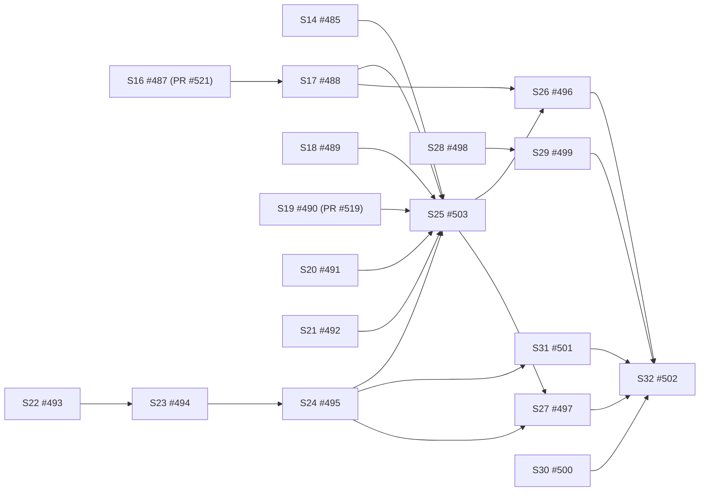

# Backlog grooming record: tedeuxx/mhw, 2026-11-20

First run of `/backlog-grooming` (Issue #522). The command text is in PR #526, which is open and not
merged into `rc/next`; this record follows its steps 4 (verdicts and seam pass) and 5 (this record).
**Nothing in this record had been applied when it was written.** No comment, label, edit or close was written on the
tracker. Step 7 applies the verdicts only after the owner's confirmation in step 6 (*Ruling*, below).

Read revision: `origin/rc/next` at `7557b5193b7c2a16ca5dc011a7534c6c7d3f27ba`. The readers were briefed
at `164eb291c`; `git merge-base --is-ancestor 164eb291c origin/rc/next` succeeds, and the only commits
between the two are PR #525 (#524, removing the `/new-idea` and `/idea-to-issues` aliases), which none
of the verdicts below depends on.

## Enumeration

```
gh issue list --repo tedeuxx/mhw --state open --limit 200 --json number --jq 'length'
```

- At enumeration time it returned **53**. #524 closed later the same day through PR #525 and is
  excluded.
- Re-run while this record was written, it returned **52**: exactly the 52 Issues below. The limit
  (200) was not reached, so the list is not truncated.
- 50 were read in five read-only partition dispatches (`agents-lead`, since every Issue here is or
  becomes `loop`). #522 and #523 were opened today, already carry `ready`, and are kept without a
  partition read.

## Counts

| verdict | count | Issues |
|---|---|---|
| keep | 21 | #79, #190, #443, #470, #485, #487, #489, #490, #491, #492, #493, #494, #495, #496, #497, #498, #499, #500, #501, #522, #523 |
| rewrite | 7 | #27, #129, #433, #434, #488, #502, #503 |
| merge | 1 | #78 into #79 |
| close | 1 | #192 (implemented elsewhere) |
| type `loop` | 13 | #428–#432, #435–#442 |
| propose ready | 0 | none |
| owner action | 9 | #26, #31, #32, #33, #131, #220, #224, #251, #466 |

Two rewrites also apply a type in the same edit (#433, #434 become `loop`), so 15 Issues gain the `loop`
label in total. Label corrections are listed separately below; they are not verdicts.

## One row per Issue

| # | Title | Verdict | Criterion | Evidence |
|---|---|---|---|---|
| #26 | Promote the firewall floor to the system-managed layer (ADR-0014) | owner action | admin act + fresh-session canary | Ruling 2026-11-17: promote through `global/install-managed.sh`; `git ls-tree --name-only 164eb291c global/` lists it. `decision` is stale (label change). |
| #27 | Guard against a repository redirecting the subscription token via ANTHROPIC_BASE_URL | rewrite | body predates the 2026-11-17 ruling | Body still says "Needs the owner's choice"; the ruling comment chose a check. `git grep -n -c ANTHROPIC_BASE_URL origin/rc/next -- src bin global` → no output: not built. `decision` is stale (label change). |
| #31 | Ask GitHub Support to purge PR #15's exposed diff | owner action | waiting on a third party (GitHub Support) | `git ls-remote origin refs/pull/15/head` still returns the ref, so Support has not acted. `decision` is stale (label change). |
| #32 | Create VERSION_BUMP_TOKEN and protect main | owner action | secret write is the owner's act | `gh secret list --repo tedeuxx/mhw` has no `VERSION_BUMP_TOKEN`; `version-main.yml:41` falls back to `github.token`. `decision` is stale (label change). Protection half to re-verify with `gh api …/protection` (owner). |
| #33 | Trust the paste-filter hook in Codex /hooks | owner action | Codex `/hooks` trust is the owner's act | `global/install.sh:43` and `:154` at `164eb291c`: the hook is installed and runs only once trusted. `decision` is stale (label change). |
| #78 | Optional container mode (Podman Desktop or Docker Desktop) for agent harness sessions | merge into #79 | one requirements document, identical rulings | Both carry the 2026-11-01 and 2026-11-17 rulings word for word; `gh pr view 248` → MERGED (agent-runtime PRD covers both). |
| #79 | Agent runtime: local containers, cloud-ready, orchestrated from a web console | keep | umbrella; merge target for #78 | Readiness belongs to the Issues `prd-to-issues` will cut after #470. "Next step" paragraph is stale (advisory). |
| #129 | Calibrate the editorial harness around a site-as-an-ongoing-book mission | rewrite | description not closed against this repository | Carriers name the plugin layout; checks name retired plugin machinery; mandatory/optional visual rule contradicts across comments. `git grep -n -i "what i thought" origin/rc/next -- method` → no output: not built. |
| #131 | Closing rites: audience analysis always, and one lead-reviewed executive report in Portuguese | owner action | built; his live check at the next sprint close | `gh pr view 413` → MERGED 2026-11-01 into rc/next; `funnel-review/SKILL.md:278` and `sprint-retrospective/SKILL.md:523` carry it. Still `ready` (label change). |
| #190 | Schedule the weekly tadeumendonca-skills sprint that drains method twins and releases the plugin | keep | waits on an event (first routine run 2026-11-23) | Comment 2026-11-17T22:22: closes once the first run is recorded. Closing comment should waive the stale `invocable:` (advisory). |
| #192 | Implement the ratified ADR-0015 ethical deployment lock | close | implemented elsewhere (#243 to #247) | All five children `CLOSED COMPLETED` 2026-11-07/08; `global/project-policy/` carries the code. No enforcement claimed anywhere. |
| #220 | Floor rule 4: secret-store acts allowed with the owner present; restrictions only when he is away from the keyboard | owner action | D8 canary rerun is his act | ADR-0040 accepted 2026-11-17 and says the rerun is the owner's. Still `ready`, `sp:5` (label change). AC2 restatement in -skills and -io untracked (#250, #252 closed NOT_PLANNED). |
| #224 | chrome-devtools MCP attaches to the owner's Chrome profile (ADR-0038 amendment) | owner action | install, fresh session, canary are his | `global/mcp/policy-servers.json:10` carries `--autoConnect`, no `--isolated`; PRs #227, #234, #237 merged; estimators: "no build scope remains". Still `ready` (label change, added by the seam pass). |
| #251 | ci: the release job's VERSION_BUMP_TOKEN expires on a calendar; move it to a GitHub App (twin of tadeumendonca-io#783) | owner action | acts 1 to 3 of the 2026-11-07 comment | Every code change is in -skills; -skills `version-main.yml:30` still uses the PAT. Twin of tadeumendonca-io#783. Already `blocked`. |
| #428 | Recoverable install: journal of writes and mhw recover | type `loop` | untyped; changes the installer | `git grep -n -i "\brecover\b" origin/rc/next -- src bin mhw global/*.py global/*.sh` → no output. After #470. |
| #429 | mhw verify: measure after install what needs no person | type `loop` | untyped; new CLI verb | No top-level `mhw verify` in `src/` (only `mhw delivery verify`). After #470. |
| #430 | Generate the ADR index from the records, with a staleness check | type `loop` | untyped; ADR tooling | `docs/adr/README.md`: "This index is maintained by hand (Issue #65)." No generator. Before #438. |
| #431 | Conversation rules: short labels, owner vocabulary, scenario line | type `loop` | untyped; brief and overlay rules | No "scenario line" or glossary in `global`, `overlay`, `method`. Blocks #432. |
| #432 | /welcome: a first-run tour generated from the command sources | type `loop` | untyped; owner command | `git ls-tree -r --name-only origin/rc/next \| grep -i welcome` → no output. Blocked by #431. |
| #433 | delivery.py merge removes the slice's worktree and local branch | rewrite | names a retired file (and type `loop` in the same edit) | `git show origin/rc/next:workspace/delivery.py` → fatal: not in rc/next; the command is `./mhw delivery merge` (`src/commands/delivery.js`, #474). Behaviour not built. |
| #434 | delivery.py merge closes the slice's Issue after the merge into rc/next | rewrite | names a retired file (and type `loop` in the same edit) | Same as #433; `git grep -nE "issue close\|closingIssues" origin/rc/next -- src/commands/delivery.js` → no match. |
| #435 | /cleanup, git classes: merged worktrees and branches | type `loop` | untyped; new tool class | No `cleanup` path in rc/next. Blocked by #433. |
| #436 | /cleanup, other classes: tool caches, container images, old backups | type `loop` | untyped; extends #435 | Not built. Blocked by #435; soft dependency on #442's images. |
| #437 | scrum-master reads the tracker itself, read-only | type `loop` | untyped; changes a profile grant | `method/agents/scrum-master.md` frontmatter `tools: []`. Blocks #438. |
| #438 | Parallel builds: shared files no longer bar a selection | type `loop` | untyped; delivery contract | `scrum-master.md:296`: "prefer a smaller set over a colliding one". Blocked by #430, #437. |
| #439 | Builder done means nothing running; head confirmed before review | type `loop` | untyped; method instructions | No "background process" or head comparison in `method/`. |
| #440 | /autonomy status: a read-only sprint status screen | type `loop` | untyped; reopens a refused subcommand | `method/commands/autonomy.md`: "The set is closed at two." Needs scrum mode (#522). |
| #441 | Session self-analysis: propose improvements from the session's evidence | type `loop` | untyped; owner command | `git grep -nl -iE session-lessons origin/rc/next` → only the PRD. At the edge of /backlog-grooming (no merge). |
| #442 | Portable suite in a native-arch container, with a local-pass marker | type `loop` | untyped; adds a gate precondition | No `local-pass` and no Containerfile in rc/next. Re-scope after #470 (suite is Node now). |
| #443 | Read site analytics through a read-only API credential, not browser scraping | keep | already `loop`; not ready | Read path is an architecture choice to settle at intake; the Viewer credential is an owner act inside it. |
| #466 | Deny floor: git -C trunk-push entries name a path that no longer exists | owner action | delete six stale lines from his user settings | PR #467 and RC #468 MERGED; `grep -F "git-reps/tadeumendonca.io/" ~/.claude/settings.json \| grep -c push` → 6 (counts only). |
| #470 | mhw is one Node CLI: one runtime for all three harnesses, shell, PowerShell and Python migrated into it | keep | parent tracker of S01–S32 | No `ready`, no `sp:`; 15 of 32 slices CLOSED. Stays out of the pool. |
| #485 | S14: Move the MCP active set and the connection check to Node | keep | ready, estimated, unblocked | S14. Blocker S13 (#484) CLOSED; `mcp_active.py`, `mcp_connect.py` still present. No PR. |
| #487 | S16: Move the paste wrapper to Node with a pty library | keep | in flight (PR #521) | S16. `global/clipboard/paste_wrapper.py` still present. |
| #488 | S17: Move the prompt hook to `mhw hook prompt --harness <h>` | rewrite | an obligation lives only in a comment | S17. Comment 2026-11-20T01:18 (S15 lens A1): `src/commands/scan.js:28-53` spawns `python3` for `SaltStore`; this slice deletes `clipboard_guard.py`. Add one AC line. |
| #489 | S18: Move the method renderer to Node | keep | ready, unblocked | S18. S04–S07, S15 CLOSED; `global/method/method_render.py` still present. |
| #490 | S19: Move the allow-list renderer to Node | keep | in flight (PR #519) | S19. `global/allow-list.sh` still present. |
| #491 | S20: Move the settings merge and the deny-floor report to Node, dropping jq | keep | ready, unblocked | S20. `merge_settings`, `report_floor` in `global/install.sh`; `prerequisites.json` lists `jq`. |
| #492 | S21: Move the shell start-up block to Node | keep | ready, unblocked | S21. `rc_*`, `shell_rc_*` in `global/install.sh`. |
| #493 | S22: Move `mhw status` to Node | keep | ready, unblocked | S22. `global/workstation.py`, `owner_actions.py` still present. Critical path. |
| #494 | S23: Move `mhw check` to Node (prerequisites, project brief, merge-authority contract) | keep | ready; blocked by S22 | S23. `prerequisites.py`, `merge_authority.py` still present. |
| #495 | S24: Move `mhw install\|update\|uninstall` and postinstall to Node; retire `workstation.py` and `./mhw` | keep | ready; blocked by S22, S23 | S24. Removes list names `workstation_test.py` without its `global/` directory (cosmetic). |
| #496 | S26: Move the admin-layer installer to `mhw install --admin` | keep | ready; owner decision before build | S26. Main risk names an unresolved owner choice (root-owned node for the admin hook); `install-managed.sh:81-83` resolves node from PATH under sudo today. |
| #497 | S27: Install on Windows through the same CLI and retire `install.ps1` | keep | ready; blocked by S24, S25 | S27. `global/install.ps1` and its suite present. |
| #498 | S28: Move the project-policy validator to `mhw check --project-policy` | keep | ready, unblocked | S28. Only blocker S01 CLOSED; `reference-delivery-gate.yml:112` still runs `project_policy.py`. |
| #499 | S29: Move the delivery gate and the reusable delivery workflows to Node | keep | ready; blocked by S28 | S29. `delivery_gate.py` called at five lines of `reference-delivery-gate.yml`. |
| #500 | S30: Move the method Issue sync to Node | keep | ready, unblocked | S30. `method-issue-sync.yml:198` allow string; the `Edit(...)` half must survive the port (advisory). |
| #501 | S31: Move the prod canary to Node | keep | ready; blocked by S24 | S31. `prod_canary.py`, `prod-canary-container.sh` present. |
| #502 | S32: Enforce one runtime in CI and record the change in an ADR | rewrite | carry-alongs live only in comments; ADR number taken | S32. Four carry-along comments (2026-11-19/20); its Adds names `docs/adr/0042-one-node-runtime.md`, while open PR #521 (S16) adds `docs/adr/0042-node-pty-vendored-for-the-paste-wrapper.md`. |
| #503 | S25: Move the `install.sh` orchestrator to Node and delete `install.sh` | rewrite | receives #502's install.sh carry-alongs | S25. Its end-to-end golden would otherwise pin the 0-byte uninstall (carry-along 4) as expected output. Reader proposed keep; the seam pass made it a rewrite because its body changes. |
| #522 | Add /backlog-grooming: refine and consolidate the whole backlog, then hand off one sprint that drains it | keep | opened today, already `ready` | This command's own Issue (PR #526 open). |
| #523 | Every MR keeps the documentation baseline current; onboarding scaffolds a default doc and test/DoD baseline with a tighten-only project override | keep | opened today, already `ready` | Not read by a partition reader; kept as briefed. |

## Label corrections (not verdicts), each with its evidence

**Remove `ready`** (built, or only the owner can move it; a drain would select it otherwise):

- **#131**: built. `gh pr view 413` → `MERGED 2026-11-01T22:51:42Z base=rc/next`; at rc/next
  `method/skills/funnel-review/SKILL.md` carries "An unreachable browser is a blocker raised to the
  owner, never a silent skip (#131)" and `method/skills/sprint-retrospective/SKILL.md` carries "Step 6 —
  the closing rites end in ONE executive report, a Claude Artifact, reviewed by three leads (#131)".
  What remains is his check at the next sprint close.
- **#220**: owner-only. ADR-0040 is accepted (2026-11-17) and says *"The rerun is the owner's act (his
  browser and his approval of the connection), not an agent's."* AC1, AC3, AC4, AC5 and AC7 are met in
  ADR-0040; the deny entries stay (`global/deny-floor.conf` still carries `cmd gh secret set`,
  `delete`, `remove`).
- **#224** (added by this seam pass, beyond the brief): owner-only, same shape. It carries `ready` and
  `sp:2`, and the 2026-11-07 planning-poker comment says *"Both estimators agree no build scope
  remains."* `global/mcp/policy-servers.json:10` already carries `--autoConnect` and no `--isolated`.

`sp:N` stays on all three: it records an estimate that was made, and nothing queries it without `ready`.

**Remove the stale `decision` label** (each has a recorded ruling or a known act):

| Issue | the ruling or act that replaced the decision |
|---|---|
| #26 | Owner ruling 2026-11-17: promote the floor through `global/install-managed.sh`, run by him with admin rights with the final `mhw install`; closes on a fresh-session canary. |
| #27 | Owner ruling comment 2026-11-17T17:50: *"the control is a check, not a hook or a managed pin … The build is now unblocked."* |
| #31 | The Support ticket was filed on 2026-11-17 from his account; only Support's act remains (`git ls-remote origin refs/pull/15/head` still returns the ref). |
| #32 | The act is known: create `VERSION_BUMP_TOKEN` and protect `main` together (`gh secret list --repo tedeuxx/mhw` shows no such secret). |
| #33 | The act is known: trust the paste-filter hook in Codex `/hooks` after the final install (`global/install.sh:43` says Codex runs it only once trusted). |

## Seam pass

Run once in the main session over the five partition summaries, not over bodies.

### Overlaps

- **#78 merges into #79.** One requirements document (`docs/mhw-product-requirements-document-agent-runtime.md`,
  PR #248) covers both, both carry the same two owner rulings, and #79's interview Q1 chose
  "container mode + web console together". Two open parents for one document is the scope
  fragmentation the readiness bar names. If he prefers to keep both, #78 stays as the container half;
  either way neither is ready before `prd-to-issues`.
- **#433, #434 and #435 are one merge-time cleanup cut in three, by design.** Each body states the seam.
  No merge. #433 and #434 both name the retired `workspace/delivery.py`; the delivery command is
  `./mhw delivery merge` (`src/commands/delivery.js`, #474). Both are rewrites with the same rename.
- **#441 sits at the edge of `/backlog-grooming` (#522, PR #526).** Both propose a note on an existing
  Issue instead of a duplicate; #441 is per session, `/backlog-grooming` per backlog. No merge. The
  #441 intake should reuse the grooming command's "search open Issues first" step rather than restate it.
- **#502 and PR #521 (S16, #487) claim the same ADR number.** #502's *Adds* names
  `docs/adr/0042-one-node-runtime.md`; open PR #521 adds `docs/adr/0042-node-pty-vendored-for-the-paste-wrapper.md`
  (`gh pr view 521 --json files`). PR #521 also amends ADR-0033, which #502's AC lists as its own.
  The #502 rewrite takes the next free number at build time and checks what S16 already amended.
- **#502's carry-alongs belong partly to #503.** Carry-alongs 3a, 3b, 3c and 4 concern `install.sh`,
  which S25 (#503) ports and deletes; left on S32 they reach the builder after the code is gone, and
  S25's end-to-end golden would pin the 0-byte uninstall as expected output.
- **#488 owns `mhw scan`'s salt read only through a comment.** `src/commands/scan.js` spawns `python3`
  for `clipboard_guard.py`'s `SaltStore`; S17 deletes that file. The rewrite makes it an AC line.
- **#129 overlaps the `content` lane's owner-read rule.** Its "exact-SHA held-preview approval
  artifact" is a second artifact beside the canonical sentence in `content-publishing` and
  `orchestration` (*his record of the read is his own comment on the release merge request, naming the
  URLs he read*). The rewrite reconciles to the existing rule instead of adding one.
- **#129's test arm lands in a file S18 removes.** The method clause assertions live in
  `global/method/method_render_test.py` (`git grep -l ARTIFACT_READ origin/rc/next`), which S18 (#489)
  ports to Node. Build #129 after #489, or write its assertions into the Node port.
- **#523 overlaps S28 (#498).** #523's override is a new optional section of `project-policy.json`
  (owner decision 2026-11-20 on #523); S28 ports the project-policy validator to Node. Order #498
  before #523, or #523 pays a golden re-record. #523 also touches `docs/adr/README.md`'s role in the doc
  baseline, which #430 generates; edge only.
- **#443 and #131**: #131 owns *that* the audience analysis always runs, #443 *how* it reads the data.
  Stated seam; no merge.
- **#32 and #251** are the same token class in two repositories (mhw's and -skills' release tokens).
  Related, separate by design; not twins in the sense of one Issue mirrored.

### Dependency order found

From each Issue's own `Blocked by` line or prose (`gh issue view <n> --repo tedeuxx/mhw --json body`).
The #470 slice graph (S-id → Issue map from #470's comment 3; S25 is #503, S26 is #496):



*Read left to right; S32 needs every slice S02–S31. S01–S13 and S15 are closed.*

Layered order for the open slices:

1. Now (all blockers closed): S14 #485, S18 #489, S20 #491, S21 #492, S22 #493, S28 #498, S30 #500;
   in review: S16 #487 (PR #521), S19 #490 (PR #519).
2. After S16: S17 #488. After S22: S23 #494. After S28: S29 #499.
3. After S23: S24 #495.
4. After S24: S31 #501. After S24 and S14, S16–S21: S25 #503.
5. After S25: S26 #496 (also needs S17 and the owner decision below), S27 #497.
6. Last: S32 #502.

Critical path: S22 → S23 → S24 → S25 → S26/S27 → S32, with S14 and S17 also gating S25.

The PRD-derived Issues (#428–#442), which the #470 body says are built after the refactor:

- #430 → #438; #437 → #438.
- #431 → #432.
- #433 → #435 → #436; #436 also relies on #442's images.
- #428 and #429 are siblings (recover writes, verify reads), both after #470 moves `install` into Node.
- #442's scope is re-verified after #470 (the suite is Node now).
- #440 needs scrum mode in force (#522).

Other edges: #27 after #470 (`status` and `scan` move to Node); #78/#79 after #470, then
`prd-to-issues`; #129 after #489 (above); #523 after #498 (above); #26 and #33 after the final install
that follows #470.

### Owner actions

Outside the sprint; his hand only. The first two share one fresh session.

| # | the act |
|---|---|
| #26, #33 | After the final `mhw install` that follows #470: run the admin install (`install-managed.sh`, or its Node replacement if #470 changes it), trust the paste-filter hook in Codex `/hooks`, then the fresh-session canary showing a project setting cannot weaken the floor. |
| #32 | Create `VERSION_BUMP_TOKEN` and protect `main` **together**: protection without a token that can push past it breaks `version-main.yml`'s push. Re-verify protection with `gh api repos/tedeuxx/mhw/branches/main/protection`. |
| #31 | Wait for GitHub Support; then check that `/pull/15/files` no longer shows the diff. |
| #131 | At the next sprint close: check the closing report reaches him as a Claude Artifact, in Portuguese, naming the three reviewing leads, and that `funnel-review` asked before writing any not-collected file. |
| #220 | Rerun the real-page canary under the D8 launch, then delete `tedeuxx/mhw-canary-220`; decide whether to open the two AC2 Issues (rule 4 restated in -skills and -io), which ADR-0040 says are owed and which no Issue tracks. |
| #224 | Install, fresh session, canary; on Codex and Kiro, align his local MCP definition with `global/mcp/policy-servers.json`. |
| #251 | Acts 1 to 3 of the 2026-11-07 comment (read the protection, extend the App installation, create the App secrets). |
| #466 | After installing the release carrying #467: delete the six stale `git -C …/tadeumendonca.io/… push origin …` lines from `~/.claude/settings.json`, then close #466 as implemented by #467. |

Two owner items sit inside kept Issues:

- **#496 (S26) needs his decision before it is built**: a root-owned node copy for the admin hook,
  accept and record the gap, or keep the admin hook out of scope. It is a decision, not an act; put it to
  him as one activation when S26 is next in order. `install-managed.sh:81-83` resolves node by
  `MHW_NODE` or PATH under sudo today, so the risk is live.
- **#443** needs a Viewer-role analytics credential he creates and stores in the Keychain.

### Cross-repository twins (flagged, never consolidated)

- **#129** ↔ the product half in `tadeumendonca-io` (asset manifest, prerender, OG card, video embed,
  pull-quote component), by the Issue's own words. Its old blocker `tadeumendonca-io#687` is `CLOSED`
  (2026-10-02, `gh issue view 687 --repo tedeuxx/tadeumendonca-io`).
- **#251** ↔ `tadeumendonca-io#783` (already in its title).
- **#190** acts in `tadeumendonca-skills` (the weekly routine opens at most one PR there).
- **#220**'s AC2 restatement has no counterpart Issue in either target repository (#250 and #252 were
  closed `NOT_PLANNED` as sync duplicates). Filing them is his call.

## Proposed new bodies (rewrites and the merge target)

Each proposed body replaces the current one at step 7. The current body is in the appendix, verbatim.

### #27: proposed body

```text
## Outcome

`mhw status` and `mhw scan` name any `ANTHROPIC_BASE_URL` set in a workspace's agent harness configuration
(Claude Code: the `env` block of `.claude/settings.json` and `.claude/settings.local.json`), so a cloned
repository that would redirect the subscription bearer to another host is visible before a session runs in it.

## Why

ADR-0003 h1 (measured headless): a cloned repository's `.claude/settings.json` `env` block routed the
subscription bearer to the named host. Interactive trust-dialog behaviour is unmeasured.

## Decision (owner ruling, 2026-11-17)

The control is a check, not a hook or a managed pin. It informs; it never blocks. The managed-layer pin is
not chosen, because whether managed env beats project env is not measured.

## Acceptance criteria

- [ ] In a throwaway workspace whose `.claude/settings.json` sets `env.ANTHROPIC_BASE_URL`, `mhw status
      --project=<dir>` and `mhw scan` each name it as `file:line` and a category, never the value.
- [ ] Neither command's exit code changes because of the finding (informs, never blocks); a test asserts it.
- [ ] Calibration: removing the variable clears the finding in both commands (test).
- [ ] `settings.local.json` is covered the same way (test).
- [ ] The evidence level is stated in the README's current-state table: written and tested; a check you run,
      not enforced.

## Seam

Built in the Node CLI after #470 moves `status` and `scan` there; not on the shell or Python code.

invocable: none
```

### #129: proposed body

The Issue is large (eleven or more requirements over the body and seven comments). This rewrite keeps
the owner's editorial contract word for word and corrects only what a builder would otherwise resolve
mid-build. **Whether to split it into a textual-ruler Issue and a visual-lane Issue is his call** and is
asked in step 6 only if he wants it; the proposed body below keeps it as one.

```text
## Outcome

[Unchanged: the current body's "Outcome" section, word for word.]

Type: `loop`

Class: `boundary` — this changes the editorial machinery and the rules by which future public writing is shaped.

invocable: none

## Existing decisions and the changed premise

[Unchanged: the current body's section of that name, word for word.]

## Editorial contract

[Unchanged: the current body's "Editorial contract" section, word for word, including "The relationship with
the reader", "`THIS IS WHAT I THOUGHT`" and "Harness engineering as art".]

## The visual rule, as it stands now

The comments changed this rule three times. The current rule is the 2026-10-01T00:46 "Intake refinement":
every article carries a cover below the title and a reflective footer; the cover supplies the OG/social
card's source identity. The 2026-09-30T22:02 addendum's optional wording is superseded on this point; its
reusable editorial functions, visual brief and per-surface evidence still apply.

## Later owner refinements, carried as requirements

- Canonical technical terms stay in English in every locale (comment 2026-10-01T02:17).
- A technical acronym is expanded in English at first use (comment 2026-10-01T02:18).
- A materially cited person's first full-name mention links to the LinkedIn profile only when the identity
  is reliable and the owner confirms it (comment 2026-10-01T02:26).
- A video that carries the argument renders inline at its first substantive reference, with a visible
  accessible title link (comment 2026-10-01T02:28).
- A restrained pull-quote element may expose a section's earned conclusion; never an invented slogan
  (comment 2026-10-01T02:31).

## Canonical carriers in this repository

- `method/skills/published-voice/SKILL.md`: the reader relationship, the ongoing-book mission, the exact
  English mark and its past tense, the modern-art thesis with both boundaries, and the five refinements above.
  The current "Rule 17 — the SIGNATURE" is struck or reconciled in place.
- `method/skills/content-publishing/SKILL.md`: the visual lane (direction, generation, committed assets,
  accessible text, below-title cover, reflective footer, OG projection, pre-post OG check).
- `method/commands/new-issue.md`: content intake elicits missing visual direction one question at a time.
- The content pair's briefs consume the shared skills; nothing is copied into both.
- The owner's read of a piece is the existing rule: the application's preview mode, and his own comment on
  the release merge request naming the URLs he read. No second approval artifact is added.
- A machinery ADR in `docs/adr/` records the decision, the rejected alternative (the current article's subject
  and tone as a house style) and the costs.

## Acceptance criteria

- [ ] The shared ruler contains quotable clauses for the ongoing-book mission, situated chapters, learning
      alongside the reader, hoped-for future usefulness, the exact English mark and its past-tense meaning.
- [ ] The ruler fixes the terminal sequence: an article-specific open reflection as a quotation, then the
      invariant `THIS IS WHAT I THOUGHT · tadeumendonca.io` signature, with equivalent real text.
- [ ] The ruler carries the modern-art thesis with both boundaries, and prevents any one article's register,
      or harness engineering itself, from becoming mandatory subject matter.
- [ ] One current rule requires the cover and the reflective footer; conflicting optional wording and the old
      signature clauses are struck or reconciled in place.
- [ ] The five later refinements are quotable clauses in `published-voice`.
- [ ] `content-publishing` names the complete two-image path and says which parts are instructions rather than
      mechanisms; no hook is described as judging visual truth, alignment or owner approval.
- [ ] Content intake has a one-question-at-a-time route for missing visual direction.
- [ ] The method test asserts the canonical clauses exist and the visual step reaches the lane (in
      `global/method/method_render_test.py`, or its Node port if S18, #489, has landed); removing each
      load-bearing clause turns it red and restoring it turns it green. Its success text says presence is not
      proof that a draft obeyed them.
- [ ] A machinery ADR records the decision.
- [ ] No route taxonomy, article numbering or universal visual tone is introduced; no product-side support is
      claimed without product-side evidence (the product half is tracked in tadeumendonca-io).

## Order

After #489 (S18). The old scheduling blocker, tadeumendonca-io#687, is closed.
```

### #433: proposed body

Title: `mhw delivery merge removes the slice's worktree and local branch`

```text
## Outcome

Each merged slice leaves no worktree or local branch behind.

## Acceptance criteria

- [ ] After a merge into `rc/next`, `./mhw delivery merge` (`src/commands/delivery.js`) removes that slice's
      worktree and local branch, only when the merged head equals the local head and nothing is uncommitted.
- [ ] A test covers each refusal: a moved head, an uncommitted file, and a worktree outside this repository.
- [ ] The remote branch is not touched; a test asserts it.

## Seam

The backlog of existing worktrees belongs to the /cleanup Issues (#435, #436). Closing the Issue belongs to
its own Issue (#434). Removal goes through `git worktree remove` and `git branch -d`, never a raw delete
(the deny floor denies recursive `rm`).

invocable: none

Source: [PRD, section](https://github.com/tedeuxx/mhw/blob/rc/next/docs/mhw-product-requirements-document-blueprint-import-concepts.md#21-cleanup-at-merge)

## Readiness

- Estimate: **`sp:N` missing.** It is set by planning poker before `ready` (definition-of-ready, failing item named).
- Evidence level on merge: *written and tested*. Nothing in this Issue claims installed, loaded or enforced.
```

### #434: proposed body

Title: `mhw delivery merge closes the slice's Issue after the merge into rc/next`

```text
## Outcome

A slice's Issue closes when the slice merges into `rc/next`, not when the release candidate lands.

## Acceptance criteria

- [ ] After a merge into `rc/next`, `./mhw delivery merge` (`src/commands/delivery.js`) closes each Issue the
      PR names as closed, with a comment citing the merge commit.
- [ ] Commits keep a non-closing `Refs #N`; `workspace/README.md` says so.
- [ ] A test against the synthetic `gh` covers the PR with no Issue and the PR that names two Issues.

## Seam

Worktree cleanup at merge is the sibling Issue (#433). The release-candidate route into `main` is unchanged.
The forge does not close these Issues itself because `rc/next` is not the default branch; this command is a
new tracker write by a script, which intake states.

invocable: none

Source: [PRD, section](https://github.com/tedeuxx/mhw/blob/rc/next/docs/mhw-product-requirements-document-blueprint-import-concepts.md#34-issue-closing)

## Readiness

- Estimate: **`sp:N` missing.** It is set by planning poker before `ready` (definition-of-ready, failing item named).
- Evidence level on merge: *written and tested*. Nothing in this Issue claims installed, loaded or enforced.
```

### #488: proposed body

The current body unchanged, with one line appended to **Acceptance criteria**:

```text
- `mhw scan`'s Keychain salt read moves to Node, or the slice names where it goes: no `python3` child remains
  in `src/commands/scan.js`, and on macOS a scan still checks employer and client terms (test). (Carry-along
  from the S15 lens, comment of 2026-11-20 on this Issue.)
```

### #502: proposed body

The current body unchanged, except:

- in **Adds**, `docs/adr/0042-one-node-runtime.md` becomes
  `docs/adr/<next free number>-one-node-runtime.md` (0042 is taken by PR #521, S16, if it merges with
  that number);
- the ADR criterion's `ADR-0033 (pty wrapper, Windows not measured)` gains
  `, unless S16's ADR already amended it, in which case this ADR cites that amendment`;
- three lines appended to **Acceptance criteria**:

```text
- `test/helpers/py-probe.py`, and any other golden-recording helper, is deleted or listed in the fixture
  allowance with its reason; `runtime-guard` is red on it otherwise. (Carry-along 1, comment of 2026-11-19.)
- No golden under `test/golden/` carries a recording machine's interpreter path; the S05 `validate-not-utf8`
  golden is normalised. (Carry-along 2, comment of 2026-11-19.)
- Carry-alongs 3a, 3b, 3c and 4 (comments of 2026-11-20) moved to #503 (S25), where `install.sh` is ported.
```

### #503: proposed body

The current body unchanged, with this section appended:

```text
**Carried from #502** (carry-along comments of 2026-11-20 on #502; each is an acceptance criterion here)
- Every install-suite run uses a throwaway managed root; no test reads the real admin layer under `/Library`
  or `/etc`. (3a)
- A `settings.json` that cannot be parsed or is nested past the parser's limit is refused visibly and
  uniformly by every install step, the model-defaults step included. (3b)
- The step that ends the run on a 300-deep `settings.json` on the Ubuntu runner is identified, and the golden
  records the uniform refusal, not the crash. (3c)
- Uninstall leaves valid JSON, never a 0-byte file, for a `settings.json` whose content is
  `{"permissions": []}`; the end-to-end golden records that, not the defect. (4)
```

### #79: proposed addition (merge target for #78)

The current body unchanged, with this section appended; #78 then closes with criterion *superseded by
#79*:

```text
## Carried from #78 (container mode), verbatim

- One switch per session: host (default today), Podman Desktop or Docker Desktop.
- Runtime-neutral: one container definition that works on both runtimes; runtime-specific differences are stated.
- The same rendered configuration (managed, user and workspace layers, paste wrapper, deny floor) applies in both modes; what does not carry into the container is stated, not hidden.
- Native first: use each agent harness's own sandbox or container support where it exists before building a launcher.
- Fits the requirements document's "Why CLI first": each session is a process with the potential to run in its own container.

Open questions carried from #78:
- What the container isolates (file system, network, credentials) and which credentials enter it.
- Relation to the "SDLC runtime alignment" topic the owner raised before cutover (#63, #64).
- Enforcement coverage per agent harness, measured in the #55 matrix.

Owner, on #78: «gostaria de ter a opcao de rodar com ou sem virtualizacao baseada em podman desktop nas sessoes de harness» (I would like the option to run harness sessions with or without Podman Desktop virtualisation) and «deixe o suporte a docker desktop como outra opcoa valida» (keep Docker Desktop support as another valid option).

Requirements: `docs/mhw-product-requirements-document-agent-runtime.md` (PR #248).
```

### #192: proposed closing comment

```text
Closing: implemented elsewhere. The five child Issues #243, #244, #245, #246 and #247 are all closed as
completed (2026-11-07 and 2026-11-08), and the code is in `global/project-policy/`. Adopting the reference in
another repository stays out of scope, as this Issue's own out-of-scope list says; closing claims no
enforcement in any project's CI/CD.
```

## The sprint pool /sprint-planning would get

If the owner confirms, the eligible pool is `loop AND ready`, not `blocked`, minus #131, #220 and #224
(`ready` removed). #251 is `blocked`. In dependency order:

1. In review: #487 (S16, PR #521), #490 (S19, PR #519), #522 (PR #526).
2. Unblocked now: #485 (S14), #489 (S18), #491 (S20), #492 (S21), #493 (S22), #498 (S28), #500 (S30),
   #523 (after #498, see the seam).
3. Then: #488 (S17), #494 (S23), #499 (S29).
4. Then: #495 (S24).
5. Then: #501 (S31), #503 (S25).
6. Then: #496 (S26, owner decision first), #497 (S27).
7. Last: #502 (S32).

Rewrites of #488, #502 and #503 should land before those slices are built. #27 and #129 can join a later
pool after their rewrite, `agents-lead` intake and an `sp:N`; the 13 newly typed Issues need intake and an
estimate first.

## Ruling

Owner ruling, 2026-11-20, given through the step 6 decision picker in the Claude Code session (the
picker has no URL; this section is the record of it), verbatim:

> «Confirmar tudo»

In English: confirm everything. Step 7 applies every verdict in this record as written: the merge of
#78 into #79, the close of #192, the seven rewrites, the 15 `loop` labels, the removal of `ready` from
#131, #220 and #224, and the removal of `decision` from #26, #27, #31, #32 and #33. No `ready` is added
and no milestone is created.

## Appendix: current bodies, verbatim

Every Issue a verdict would touch, as fetched on 2026-11-20 with `gh issue view <n> --repo tedeuxx/mhw --json body` (and `--json comments` for rewrites and merges, whose rulings live in comments). Nothing here is edited. The acceptance-criteria lines are extracted from the body, and from comments where a comment carries them, and repeated so a verdict that removes them loses nothing.

### #26: Promote the firewall floor to the system-managed layer (ADR-0014)

Touched by: label change (remove `decision`).

**Current body:**

```text
Owner decision and act (admin rights). The managed layer is the only non-overridable one: user hooks can be disabled by a project (disableAllHooks), and a repo-level ANTHROPIC_BASE_URL can redirect the subscription token (ADR-0003 h1). Proposal only.
```

**Acceptance-criteria lines (body):**

None in the body.

### #27: Guard against a repository redirecting the subscription token via ANTHROPIC_BASE_URL

Touched by: rewrite; label change (remove `decision`).

**Current body:**

```text
Finding from ADR-0003 h1 (measured headless): a cloned repo's .claude/settings.json env block routed the subscription bearer to the named host. Interactive trust-dialog behaviour unmeasured. Candidate controls: managed allowedProviders pin, or a user-level guard. Needs the owner's choice.
```

**Acceptance-criteria lines (body):**

None in the body.

<details><summary>1 comment(s), verbatim</summary>

**2026-11-17T17:50:18Z** (https://github.com/tedeuxx/mhw/issues/27#issuecomment-6956224479)

```text
Owner ruling, 2026-11-17 (picker, "Checagem no mhw status"): the control is a check, not a hook or a managed pin. `mhw status` and `mhw scan` name any `ANTHROPIC_BASE_URL` set in a workspace's harness config (Claude Code `.claude/settings*.json` env block). It informs; it never blocks. The managed-layer pin is not chosen, because whether managed env beats project env is not measured. The build is now unblocked.
```

</details>

### #31: Ask GitHub Support to purge PR #15's exposed diff

Touched by: label change (remove `decision`).

**Current body:**

```text
Owner act. PR #15 was closed unmerged because it disclosed owner activity detail; refs/pull/15/head and its diff view stay readable until GitHub Support removes them.
```

**Acceptance-criteria lines (body):**

None in the body.

### #32: Create VERSION_BUMP_TOKEN and protect main

Touched by: label change (remove `decision`).

**Current body:**

```text
Owner act (secret writes are denied to agents). Today the bump workflow pushes with the default token to an unprotected main.
```

**Acceptance-criteria lines (body):**

None in the body.

### #33: Trust the paste-filter hook in Codex /hooks

Touched by: label change (remove `decision`).

**Current body:**

```text
Owner act. The managed Codex hooks.json is installed, but Codex skips an untrusted hook silently.
```

**Acceptance-criteria lines (body):**

None in the body.

### #78: Optional container mode (Podman Desktop or Docker Desktop) for agent harness sessions

Touched by: merge source (into #79).

**Current body:**

```text
Owner request, 2026-10-05:

> "gostaria de ter a opcao de rodar com ou sem virtualizacao baseada em podman desktop nas sessoes de harness"

Owner, 2026-10-05, follow-up:

> "deixe o suporte a docker desktop como outra opcoa valida"

In English: the owner wants to choose, per session, whether an agent harness session (Claude Code, Codex, Kiro CLI) runs directly on the host or inside a container, with Podman Desktop and Docker Desktop both valid container runtimes.

## Behaviour (to be refined in a requirements interview)
- One switch per session: host (default today), Podman Desktop or Docker Desktop.
- Runtime-neutral: one container definition that works on both runtimes; runtime-specific differences are stated.
- The same rendered configuration (managed, user and workspace layers, paste wrapper, deny floor) applies in both modes; what does not carry into the container is stated, not hidden.
- Native first: use each agent harness's own sandbox or container support where it exists before building a launcher.
- Fits the requirements document's "Why CLI first": each session is a process with the potential to run in its own container.

## Open questions
- What the container isolates (file system, network, credentials) and which credentials enter it.
- Relation to the "SDLC runtime alignment" topic the owner raised before cutover (#63, #64).
- Enforcement coverage per agent harness, measured in the #55 matrix.

Part of #52. Requirements: `docs/mhw-product-requirements-document-project.md`.
```

**Acceptance-criteria lines (body):**

None in the body.

<details><summary>4 comment(s), verbatim</summary>

**2026-11-01T17:58:34Z** (https://github.com/tedeuxx/mhw/issues/78#issuecomment-6561721416)

```text
Owner ruling (2026-11-01): run one requirements interview (`/new-prd`) covering both #78 (container mode) and #79 (agent runtime and web console); readiness follows the agreed requirements document and the Issues cut from it.
```

**2026-11-01T18:16:06Z** (https://github.com/tedeuxx/mhw/issues/78#issuecomment-6561929481)

```text
Interview decisions recorded on #79 (2026-11-01); one requirements document covers both.
```

**2026-11-01T18:22:45Z** (https://github.com/tedeuxx/mhw/issues/78#issuecomment-6562008431)

```text
Owner, 2026-11-01 (translated): the local-container agent factory Issues are left for future sprints, not planned now. The requirements document (PR #248) proceeds to the gate; cutting it into Issues (`prd-to-issues`) and `ready` wait for a future sprint.
```

**2026-11-17T21:41:08Z** (https://github.com/tedeuxx/mhw/issues/78#issuecomment-6961793743)

```text
Owner ruling, 2026-11-17 (picker, "Entram, depois do Node"): this enters the current drain, after #470 (one Node runtime). The requirements document from PR #248 is cut into Issues with prd-to-issues once the Node base slice lands, and built before the one final install. This replaces the 2026-11-01 deferral.
```

</details>

### #79: Agent runtime: local containers, cloud-ready, orchestrated from a web console

Touched by: merge target (from #78).

**Current body:**

```text
Owner, 2026-10-05:

> "acho que precisamos alinhar runtime de sdlc com agent harness em algum momento antes de cutover dessa configuracao de workstation."

> "idealmente queremos trabalahr com containers local para facilitar levar isso pra cloud em algum momento e ter um console UI/UX web orquestrando isso"

In English: before the workstation configuration cutover (#63, #64), align the SDLC runtime with the agent harnesses. The target is agent harness sessions running in local containers (#78), so the same setup can later move to the cloud, with a web console (UI/UX) that orchestrates them.

## Current runtime (for context)
- Agent harness sessions run as plain terminal processes on the owner's machine, under his user, with no sandbox; subagents run inside the same process; each slice is isolated only by a git worktree.
- Tests, analysis and release run on GitHub-hosted CI runners.

## Next step
This is a new idea, not yet a slice: it goes through the requirements route first (an interview, then a requirements document, then Issues), per the workflow in the requirements document. Open topics for that interview: what the console shows and controls, how containers get credentials, local-to-cloud portability boundary, cost, and which agent harnesses can run headless in a container (measured in #55).

Related: #78 (container mode), #55 (native matrix), #63 and #64 (cutover). Part of #52.
```

**Acceptance-criteria lines (body):**

None in the body.

<details><summary>5 comment(s), verbatim</summary>

**2026-11-01T17:58:33Z** (https://github.com/tedeuxx/mhw/issues/79#issuecomment-6561721185)

```text
Owner ruling (2026-11-01): run one requirements interview (`/new-prd`) covering both #78 (container mode) and #79 (agent runtime and web console); readiness follows the agreed requirements document and the Issues cut from it.
```

**2026-11-01T18:16:05Z** (https://github.com/tedeuxx/mhw/issues/79#issuecomment-6561929244)

```text
## Requirements interview, 2026-11-01 (owner's decisions, translated)

- Q1 scope v1: owner chose **container mode + web console together** (over container-only first, or native sandbox only).
- Q2 purpose: owner answered **all three** — isolate the host, cloud portability, parallel sessions (his words: "os tres").
- Q3 credentials and state: owner, translated: "for authentication, cookies and session, mapping a volume makes sense. git and the rest must be ephemeral inside the container; that is one of the advantages." → auth/session state persisted in mapped volumes per agent harness (and gh); the repository is cloned fresh inside each container and discarded with it; work leaves only by push.
- Q4 console scope v1: owner chose **full orchestration** — observe, session lifecycle, trigger the drain, approve gates, merge. Constraint carried from the floor: the console is an owner surface; the rc/next → main merge still needs his explicit act there, and agents reach no new merge path through it.
- Q5 network: owner chose **open egress**, as on the host today (stated consequence: the container does not guard against exfiltration; the firewall's paste cleaning and outbound scan remain the content controls).
- Added by the owner mid-round, translated: "it also needs a tty session with the container, I think from the console" → the console opens an interactive terminal (TTY) attached to a running session's container.
- Q6 agent harnesses v1: **all three CLIs** (Claude Code, Codex, Kiro CLI), Linux, headless-capable; Kiro login inside a container to be measured.
- Q7 console access: **localhost only** (127.0.0.1, no own login in v1); cloud hosting is phase 2.
- Q8 firewall inside the container: owner chose **mount from the host** (read-only) — no rebuild on policy change; stated consequence: couples the container to the host and does not carry to the cloud, so the cloud route for the layers stays an open decision for phase 2.
- Settled before the interview (#78 body, owner 2026-10-05): Podman Desktop and Docker Desktop are both valid runtimes; host mode stays available; one runtime-neutral container definition.

Open: firewall layers in a cloud runtime (phase 2); Kiro CLI login in a container (to measure).
```

**2026-11-01T18:21:15Z** (https://github.com/tedeuxx/mhw/issues/79#issuecomment-6561990962)

```text
## Follow-up decisions, 2026-11-01 (the five points found while writing the document)

- Open 1 (console access by host agents): owner chose **a passkey / Touch ID (WebAuthn) per merge or approve action**; other console actions need no step.
- Open 2 (Claude Code settings and login share one directory on Linux): owner chose **copy the host policy into the volume at each container start** (stated cost: the copy is writable, so an agent can alter it for that container's life).
- Open 3 (paste in the console's browser terminal): owner chose **clean in the console** — the paste runs through the shared detection engine before reaching the TTY.
- Open 4 (parallel sessions): owner chose **a configurable ceiling, default 3**, held in the overlay; the console refuses to start beyond it.
- Open 5 (base image): owner chose **an official Linux image pinned by digest, rebuilt weekly** to pick up agent harness updates.
```

**2026-11-01T18:22:46Z** (https://github.com/tedeuxx/mhw/issues/79#issuecomment-6562008645)

```text
Owner, 2026-11-01 (translated): the local-container agent factory Issues are left for future sprints, not planned now. The requirements document (PR #248) proceeds to the gate; cutting it into Issues (`prd-to-issues`) and `ready` wait for a future sprint.
```

**2026-11-17T21:41:09Z** (https://github.com/tedeuxx/mhw/issues/79#issuecomment-6961794156)

```text
Owner ruling, 2026-11-17 (picker, "Entram, depois do Node"): this enters the current drain, after #470 (one Node runtime). The requirements document from PR #248 is cut into Issues with prd-to-issues once the Node base slice lands, and built before the one final install. This replaces the 2026-11-01 deferral.
```

</details>

### #129: Calibrate the editorial harness around a site-as-an-ongoing-book mission

Touched by: rewrite.

**Current body:**

```text
## Outcome

Calibrate the editorial harness so `tadeumendonca.io` is written as an ongoing book: each article is a situated chapter in an unfinished learning journey, and the reader learns alongside the owner rather than receiving a final doctrine from him.

The hope is that the work may someday help someone as books have helped him. That usefulness remains a hope offered to the future, never a claim that the site has already earned importance.

Every article publication also gains a recurring two-image composition. A cover visual directly below the article title opens the chapter through an AI-generated interpretation of its sourced memory or metaphor. A footer visual, after the final substantive act, returns the article’s question to the owner and reader as a reflective mirror. The cover supplies the source identity for the social/OG card. The terminal editorial block then carries one article-specific open reflection as a quotation, followed by the fixed mark `THIS IS WHAT I THOUGHT · tadeumendonca.io`. The phrase means “the thought I reached at that point in the journey,” not “the final truth.”

Type: `loop`

Class: `boundary` — this changes the editorial machinery and the rules by which future public writing is shaped.

invocable: none

## Existing decisions and the changed premise

The current editorial ruler already establishes journey over authority, two audience tiers, source-bounded authorship, explicit takeaways reinforced visually, and a textual article signature. The publishing lane already carries the drafting pair, held preview, per-article OG check and social distribution.

This request changes and extends those decisions:

- the site is not merely a living portfolio; its durable reader relationship is an ongoing book whose chapters remain situated in time;
- the signature is not a claim of present or final certainty: `THIS IS WHAT I THOUGHT` explicitly marks the thought reached at that moment;
- a visual takeaway is no longer sufficient by itself: every article publication carries a sourced cover below the title and a sourced reflective footer, while the cover supplies the basis of its OG/social card;
- the existing title-only OG treatment is no longer the intended editorial endpoint;
- harness-making is part of the owner’s artistic practice — the medium, workshop and editorial discipline — without becoming the mandatory subject of every article.

The current skills tree contains no carrier for the exact phrases or decisions above. The consuming product already has a generated per-article OG pipeline, but its current generator renders the article title over existing art and carries no AI-generated editorial-interpretation convention. That is a product capability boundary, not evidence that the harness rule already exists.

## Editorial contract

### The relationship with the reader

- Treat the site as an ongoing book and each article as a situated chapter.
- Write beside the reader: the owner shares what he is learning now, and the two audience tiers can learn alongside him.
- State future usefulness conditionally. Never convert the hope that this work may help someone into self-awarded legacy, authority or importance.
- Preserve the existing source constraint: the harness may shape, cut, structure and translate what the owner supplied; it may not invent the experience, feeling, position or lesson.
- Preserve each piece’s own form, source and emotional register. The Star Trek, NVIDIA and family-memory material belongs to the article that supplied it; it is not the house style.
- “Chapter” is an editorial relationship, not a requirement for numbered articles, chronological navigation, a series taxonomy or a new route structure.

### `THIS IS WHAT I THOUGHT`

- Treat `THIS IS WHAT I THOUGHT` as the exact English editorial mark.
- Its past tense is load-bearing: it identifies a thought reached at a point in the journey and leaves later revision intellectually honest.
- Every article ends with one article-specific open reflection set as a quotation, followed immediately by the fixed `THIS IS WHAT I THOUGHT · tadeumendonca.io` signature. The quotation changes with the chapter; the signature does not.
- The terminal quotation preserves a live question, uncertainty or thought left to time and dialogue. It must arise from that article’s sourced journey and must not be reused as a generic slogan.
- Reconcile the current signature rule in the same change. Do not leave “This is what I think,” “the English tense is still open,” or “the signature is the final textual line” simultaneously current where they contradict the new visual closing.
- Keep the Portuguese textual treatment as a separate locale decision unless the owner explicitly changes it; do not manufacture a translation ruling from the English mark.
- The visual mark must not be the only accessible carrier of its meaning. The article and metadata must preserve equivalent real text for readers and machines that do not read pixels.

### Harness engineering as art

Carry the owner’s thesis in its situated, provocative form:

> Harness engineering is the new modern art.

Here, “modern art” intentionally means the art of this computing moment, not a claim about art-history periodization. The supporting frame is:

- language is the material;
- constraints are the form;
- models are the instruments;
- feedback is the composition;
- emergent behaviour is the work;
- Git is memory and provenance.

This is a claim the owner may develop into a future chapter. It is not a universal definition imposed by the harness, and it does not require every article to discuss harness engineering.

## Canonical carriers and propagation

- `skills/published-voice/SKILL.md` is the canonical home for the reader relationship, the ongoing-book mission, situated-thought semantics, the exact English mark and the boundary around the modern-art thesis.
- `skills/content-publishing/SKILL.md` carries where the visual artifacts enter the lane: article-sourced art direction, generation, committed selected assets, accessible text, held-preview validation, below-title cover placement, reflective footer placement, OG projection from the cover identity and the existing pre-post OG check.
- `commands/new-issue.md` gains only the content-intake application: when a piece has no visual direction in its source, elicit it from the owner one question at a time. Do not repeat the global mission in every Issue and do not offer options in the interview.
- `agents/content-writer.md` and `agents/content-reviewer.md` continue to consume the shared ruler and lane. Do not duplicate the editorial contract into both briefs. Change a brief only where a persona-specific action cannot live in either shared skill.
- Record the cross-cutting decision in the methodology ADR library, including the strongest rejected alternative: turning the current article’s subject and tone into a mandatory house style.
- Update the blueprint/inventory projection where it describes these capabilities, regenerate the Kiro Power export from source, and leave manifests consistent through the repository’s governed generation/versioning path.

## Visual-artifact contract

For every article publication:

1. Both visual directions are derived from the article’s sourced experience and argument; the image generator may interpret that material but may not originate a new stance for the owner.
2. The selected AI-generated cover and footer are durable, committed artifacts before the held preview. Transient generated images in chat are not delivery.
3. The cover sits directly below the title, before the body begins. It opens the chapter through a central memory or metaphor.
4. The footer sits after the final substantive act and acts as a reflective mirror: it returns the article’s live question to the owner and reader. It does not replace the explicit takeaways, CTA or warm sign-off.
5. After the footer, the terminal editorial block carries the article-specific reflection as a real-text quotation and then the fixed `THIS IS WHAT I THOUGHT · tadeumendonca.io` signature. Load-bearing meaning must not exist only inside the raster.
6. The corresponding OG/social card uses the cover’s visual identity, allowing a bounded crop or composition variant rather than forcing the in-article raster into a different aspect ratio.
7. The card is not merely the current title watermark. It visibly carries the interpretation, localized title, `THIS IS WHAT I THOUGHT`, and a subtle `tadeumendonca.io` mark.
8. The two functions are stable from article to article while the scenes change. Do not mandate a universal subject, mood or art style beyond the recognizable composition and signature.
9. The held preview is where the owner validates both interpretations and their placement. A generated image is never treated as automatically approved because its prompt was sourced.
10. The existing pre-publication OG check still runs against the actual served card before either social post is made.

This Issue defines the harness contract. It must not claim that the consuming site already implements the new article figure or AI-card projection. Any product implementation remains separately tracked and gated in `tadeumendonca-io`.

## Acceptance criteria

- The shared ruler contains quotable clauses for the ongoing-book mission, situated chapters, learning alongside the reader, hoped-for future usefulness, the exact English mark and its past-tense meaning.
- The ruler fixes the terminal sequence: article-specific open reflection as a quotation, then the invariant `THIS IS WHAT I THOUGHT · tadeumendonca.io` signature.
- The ruler carries the modern-art thesis with both boundaries: situated owner claim, and “art of this moment” rather than historical periodization.
- The ruler explicitly prevents the current article’s Star Trek/NVIDIA register, or harness engineering itself, from becoming mandatory subject matter.
- The old signature clauses are struck or reconciled in place so no contradictory current rule survives.
- The publishing lane names the complete two-image path from sourced directions through below-title cover and reflective-footer placement, held preview and cover-derived OG/social validation, and says which parts are instructions rather than mechanisms.
- Content intake has a one-question-at-a-time route for missing visual direction without turning every intake into a questionnaire.
- The content pair reaches the new rules through the existing shared preloads; no second ruler is authored in the persona briefs.
- A machinery ADR records the decision, rejected alternative and costs.
- The inventory suite asserts both halves: canonical clauses exist in the ruler and the visual step reaches the lane. Its success text says presence is not proof that a draft obeyed them.
- Calibrate the new checks by removing each load-bearing subject clause in turn, observing red, restoring it and observing green.
- Regenerate the Power export and prove the generated copy matches the canonical skills.
- Existing content-pair, inventory, generated-export and distribution regressions remain green.
- No route taxonomy, article numbering or universal visual tone is introduced by this Issue.
- No product-side support is claimed without product-side evidence.

## State-model pass

- **Type:** `loop`.
- **Filed:** the owner requested the change; the Issue records it.
- **Description closed:** `agents-lead` alone; recorded by this body plus the intake stamp.
- **Ready:** remains the owner’s decision. The main session applies `ready` only after his decision is recorded on the Issue.
- **In progress:** a fresh `agents-lead` implementation dispatch and an open merge request.
- **Reviewed:** a separate fresh `agents-lead` lens marker on the merge request, then the independent quality-assurance gate.
- **Closed:** merge under the boundary verdict after every required artifact is current-head valid.

No new workflow state or label is introduced.

## Scheduling and blocker

Registration only. Do not create a branch or begin implementation while the current publication lane for `tadeumendonca-io#687` is still active.

After that publication reaches a terminal state, resume the already-admitted maximum-priority `tadeumendonca-skills#552` work. This filing does not silently preempt tedeuxx/mhw#398; any different order is the owner’s explicit planning decision.

File this Issue with no milestone.

## Intake stamp

Intake: `agents-lead`, 2026-09-30  
Repository state read: `06371da73a52ae5a116d85dce07ddaccb31e27c2`  
Installed plugin: `2.0.102`, source `06371da73a52ae5a116d85dce07ddaccb31e27c2`
```

**Acceptance-criteria lines (body):**

```text
- The shared ruler contains quotable clauses for the ongoing-book mission, situated chapters, learning alongside the reader, hoped-for future usefulness, the exact English mark and its past-tense meaning.
- The ruler fixes the terminal sequence: article-specific open reflection as a quotation, then the invariant `THIS IS WHAT I THOUGHT · tadeumendonca.io` signature.
- The ruler carries the modern-art thesis with both boundaries: situated owner claim, and “art of this moment” rather than historical periodization.
- The ruler explicitly prevents the current article’s Star Trek/NVIDIA register, or harness engineering itself, from becoming mandatory subject matter.
- The old signature clauses are struck or reconciled in place so no contradictory current rule survives.
- The publishing lane names the complete two-image path from sourced directions through below-title cover and reflective-footer placement, held preview and cover-derived OG/social validation, and says which parts are instructions rather than mechanisms.
- Content intake has a one-question-at-a-time route for missing visual direction without turning every intake into a questionnaire.
- The content pair reaches the new rules through the existing shared preloads; no second ruler is authored in the persona briefs.
- A machinery ADR records the decision, rejected alternative and costs.
- The inventory suite asserts both halves: canonical clauses exist in the ruler and the visual step reaches the lane. Its success text says presence is not proof that a draft obeyed them.
- Calibrate the new checks by removing each load-bearing subject clause in turn, observing red, restoring it and observing green.
- Regenerate the Power export and prove the generated copy matches the canonical skills.
- Existing content-pair, inventory, generated-export and distribution regressions remain green.
- No route taxonomy, article numbering or universal visual tone is introduced by this Issue.
- No product-side support is claimed without product-side evidence.
```

**Acceptance-criteria lines (comment 2026-10-01T00:46:48Z, https://github.com/tedeuxx/mhw/issues/129#issuecomment-6099743135):**

```text
- One current rule requires an article cover and reflective footer; conflicting optional wording is removed or struck.
- `published-voice` carries quotable clauses for argumentative alignment, localized accessibility, illustration honesty, social anticipation, and the distinction from the real-text terminal signature.
- `content-publishing` carries the visual brief, committed assets, preview inspection, exact-SHA approval artifact, social revision, attachment plan, and per-surface evidence.
- Product checks may make missing locale fields/assets, invalid dimensions, or a missing real-text signature red once implemented separately.
- Inventory tests assert canonical clauses and shared preloads; deleting each load-bearing clause makes the suite red and restoring it makes the suite green.
- The Kiro Power is regenerated from canonical skills and remains documented as knowledge-layer only.
- No rule is copied into both editorial persona briefs.
- No hook is described as judging visual truth, argumentative alignment, owner approval, or browser-extension publication.
- The written release protocol refuses clearance without the exact-version approval artifact while admitting no hook authenticates or observes the read.
- #687 remains the corrective content WIP; tedeuxx/mhw#129 implementation does not start until it reaches its terminal condition.
```

<details><summary>10 comment(s), verbatim</summary>

**2026-09-30T20:57:58Z** (https://github.com/tedeuxx/mhw/issues/129#issuecomment-6099743059)

```text
## agents-lead — intake stress test (not the gate's artifact)

The lens is CLOSED against installed plugin `2.0.102` at `06371da73a52ae5a116d85dce07ddaccb31e27c2`.

- A skills-only change cannot claim that the consuming site implements the new article figure or AI-card projection. Check: keep product implementation separately tracked and require served-site evidence before claiming support.
- Duplicating the contract into both content persona briefs would create competing rulers. Check: keep the canonical clauses in `published-voice` and the lane in `content-publishing`; change a persona brief only for a persona-specific action.
- “Ongoing book” could accidentally become article numbering, route taxonomy or compulsory chronology. Check: assert that it is a reader relationship, not navigation architecture.
- “Harness engineering is the new modern art” could be flattened into an art-history definition or a universal claim. Check: preserve it as the owner’s situated thesis about the art of this computing moment.
- The past-tense visual signature could coexist with contradictory current signature rules. Check: reconcile the old clauses in the same change and leave one current English mark.
- The current article’s Star Trek, NVIDIA and family-memory register could become a mandatory house style. Check: record that rejected alternative in the machinery ADR and preserve each piece’s sourced emotional register.

This intake advises only. It is not an independent gate verdict and does not start implementation.
```

**2026-09-30T22:02:21Z** (https://github.com/tedeuxx/mhw/issues/129#issuecomment-6099743097)

```text
## Addendum — reusable visual grammar and publication evidence

This addendum narrows the earlier “every article carries two images” wording. The repeatable unit is a set of editorial functions, not a recurring cast, scene, subject or fixed image count:

- **opening memory / entry** — used when the article has a sourced memory or metaphor that benefits from a visual entrance;
- **argument bridge** — optional and technique-free; it may use whatever visual device helps the article carry its argument;
- **reflective close** — used when the article calls for a visual mirror that returns its live question to the owner and reader;
- **terminal signature** — invariant real text: one article-specific open quotation followed by `THIS IS WHAT I THOUGHT · tadeumendonca.io`.

People, characters, objects, place, era, visual style, anachronism and easter eggs are variables supplied by the article. No current article’s father, fictional characters, political miniatures, historical period, visual style or playful devices become defaults for future work. Do not name this grammar as a method or framework.

Every visual brief classifies each material element as **factual**, **symbolic** or **playful**. An anachronistic or synthetic composition must not masquerade as photography or historical record; where that confusion is plausible, the rendered piece labels it as an illustration. A third party may not be depicted in a way that implies unsupported attendance, relationship, endorsement, speech or stance. Quotes and the terminal signature remain accessible text rather than raster-only meaning.

For each article, the editorial pair produces one durable visual brief containing:

- the visual thesis;
- the selected slot/function and whether it is required or omitted for this article;
- opening, bridge and closing briefs as applicable;
- a provenance and honesty matrix classifying factual, symbolic and playful elements;
- generation prompts and negative constraints;
- PT/EN alt text and captions;
- a crop/use matrix for article, OG, LinkedIn and X;
- a social attachment plan;
- the terminal quotation and signature block;
- a check that the core reading still works when every easter egg is missed.

The brief is an authored instruction and review artifact. It can record the decision; it cannot prove that a generated scene is honest, that symbolism lands or that a third-party implication is absent. Those remain editorial reads against the source.

### Asset manifest and derived checks

The consuming product’s implementation should derive or maintain one per-article asset manifest with, at minimum:

- slot/function;
- master asset and every derivative;
- provenance classification;
- locale;
- alt text and caption;
- decorative flag;
- focal point and crop constraints;
- declared uses by article, OG, LinkedIn and X.

Mechanical checks may prove only what they can read: referenced files exist; dimensions and aspect ratios match their declared uses; required localized alt text exists; embedded text, where unavoidable, has the required localized derivative; the quotation and signature also exist as real text; and the prerendered article declares a valid per-article OG image. Every new check is calibrated by breaking its subject, observing red, restoring it and observing green.

Rendered evidence is separate from manifest evidence. Validate desktop and mobile in PT and EN for placement, crop, accessible text and illustration labelling. A green manifest cannot prove the rendered composition.

### Social attachment and OG are separate obligations

Each LinkedIn and X publication natively attaches the same selected article illustration, or a platform crop derived from the same master. Recreating an unrelated social image does not satisfy this requirement.

OG validation remains a separate pre-publication obligation: inspect the prerendered metadata and the served image for the article URL. Do not promise that a native attachment and the OG card will render simultaneously. LinkedIn documents image posts and URL-preview posts as mutually exclusive, while X permits photos and links but does not promise simultaneous card rendering:

- https://www.linkedin.com/help/linkedin/answer/a527229/
- https://www.linkedin.com/help/linkedin/answer/a525063
- https://help.x.com/en/using-x/how-to-post
- https://help.x.com/en/using-x/picture-descriptions

Evidence is collected per surface:

- LinkedIn evidence proves the attached asset and article URL on LinkedIn;
- X evidence proves the attached asset, its description and article URL on X;
- OG inspection proves the article metadata and served card.

None of those artifacts proves the other, and none may be described as proof of simultaneous native-media and card rendering.

### Harness carriers and honest enforcement

- `published-voice` carries the functional grammar, optionality, sourcing and honesty constraints, illustration labelling, accessible-text rule and invariant terminal signature.
- `content-publishing` carries creation of the per-article brief, selected committed assets, manifest handoff, held-preview reads, native social attachment plan, separate OG validation and the required evidence per surface.
- Content intake asks one question at a time only when the source does not settle the visual direction.
- Inventory/export checks may assert that these clauses and artifact fields are present and propagated. They do not prove that an editorial agent obeyed them.
- Product-side asset, prerender and rendered-page checks require separately tracked implementation and evidence in `tadeumendonca-io`; this Issue must not claim that capability already exists.
- No hook can judge whether an image is truthful, whether an implication is honest, whether an easter egg is harmless or whether a network displayed two presentation modes together. Those remain instructions plus observed surface evidence, not mechanical enforcement.

## Intake refinement

State-model impact: none. This remains a `loop` item; `agents-lead` alone closed this refinement; the owner still decides `ready`; no new label, state or second Issue is introduced.

Honest enforcement claim: the skills change can mechanically preserve clauses, manifest shape and export parity. Product checks can prove asset and rendered properties. Editorial truth, symbolic interpretation, third-party implication and live social presentation remain human-reviewed or surface-observed facts.

Source applied: installed plugin `2.0.102` at `06371da73a52ae5a116d85dce07ddaccb31e27c2`; the native `2.0.99` snapshot was treated as stale.

The agents-lead intake lens is CLOSED. This comment is intake refinement, not a gate artifact and not the start of implementation.
```

**2026-10-01T00:46:48Z** (https://github.com/tedeuxx/mhw/issues/129#issuecomment-6099743135)

```text
## Intake refinement — recurring visual pair, social anticipation, and preview approval evidence

### Non-duplication

This is not new work. Issue tedeuxx/mhw#129 already owns the recurring visual editorial identity, the canonical `published-voice` and `content-publishing` carriers, localized accessibility, durable visual briefs, native social attachments, separate OG evidence, and the honest limit between instructions and mechanical checks.

The correction on `tadeumendonca-io#687` closes three gaps inside tedeuxx/mhw#129:

1. the latest addendum made opening and reflective-close functions optional, while the owner's current ruling makes the cover/footer pair recurring and mandatory for articles;
2. native attachment was specified, but social prose was not required to anticipate and interpret the illustrations as part of the editorial signature;
3. the held-preview step existed, but no version-bound artifact distinguished approval of the final deployed preview from an earlier confirmation.

Therefore refine tedeuxx/mhw#129; do not create a competing Issue.

### Refined outcome

Every article publication carries a recurring generative-AI visual pair:

- a cover directly below the title, derived from the article's sourced memory, metaphor, or central argument;
- a reflective footer in the closing movement, derived from the article's live question and aligned with the argument rather than merely occupying the correct position.

The argument bridge remains optional. Cast, scene, period, style, easter eggs, brands, and emotional register remain article-specific. The recurring identity is the pair's editorial function, localized accessibility treatment, and relationship to the terminal signature—not a reusable scene or house illustration style.

LinkedIn and X copy must explicitly prepare the reader for the attached generative-AI illustrations and explain their editorial relationship to the article. Merely attaching assets, listing their order, or labelling them AI-generated does not satisfy the rule.

### Canonical carriers

- `skills/published-voice/SKILL.md`: quotable rules for the mandatory cover and reflective-footer functions; source-bounded argumentative alignment; localized accessible text and visible AI labelling; social anticipation; and the distinction between the visual pair and the invariant terminal textual signature.
- `skills/content-publishing/SKILL.md`: durable visual brief; selected committed assets before preview; PT/EN alt text and captions; article/OG/LinkedIn/X use declarations; inspection of both held editions; exact-version owner approval evidence; revised social drafts and native attachment evidence.
- `content-writer` and `content-reviewer` continue to receive both shared skills through their identical preloads. Do not duplicate the contract into their briefs.
- The editorial meaning must live in `published-voice`; a lane-only clause would inform `content-reviewer` but would not authorize a repair under its two-ground mandate.

### Exact-version held-preview approval artifact

The transition from held preview to release leaves one durable artifact on the content Issue containing:

- both final held-preview URLs;
- the full deployed commit SHA reviewed;
- the owner's exact approval or send-back decision;
- the decision date.

A prior art-direction answer, approval of an earlier commit, merge approval, or confirmation of another publication step does not satisfy the transition. The release cites the artifact and held SHA it promotes. This makes the transition auditable and version-specific; it does not authenticate the owner mechanically, prove the URLs were opened, or create a hook-level refusal.

### Social-copy test

For each network draft:

- the prose introduces or frames the cover and reflective-footer illustrations;
- it connects their two functions to the article's argument;
- it identifies them as generative-AI illustrations without presenting synthetic scenes as documentary evidence;
- it remains meaningful with native attachments present and does not promise simultaneous native-media and OG rendering;
- platform-native descriptions are supplied where supported, while localized article alt text and captions remain the durable accessible source.

Falsifier: remove the attachment plan and image references from the publication package. If the post copy remains complete and unchanged, it did not anticipate the illustrations and fails.

### Layer and force analysis

| Concern | Carrier | Actual force |
|---|---|---|
| whether the images belong to the argument | `published-voice`, editorial review, held preview | human judgement; no hook can decide it |
| whether social prose anticipates the images | `published-voice`, applied by the content pair | citable and repairable instruction; no matcher reads a draft |
| asset existence, dimensions, locale fields, declared uses, real-text signature | consuming-product manifest/tests | mechanical only after separately tracked product implementation |
| exact-version preview approval | Issue artifact plus release/gate read | auditable precondition; not authenticated or hook-enforced |
| clause/preload/export preservation | inventory and generated-export tests | mechanical presence and propagation only |
| what LinkedIn/X displayed | per-surface observation | runtime evidence after posting |
| browser-extension publication | no plugin matcher | uncontained and unobservable; owner-in-chair remains the accepted containment |

Kiro receives the generated knowledge-layer export only—no persona or enforcement layer. Claude Code and Codex must likewise be described according to measured carriers; export parity is not runtime-enforcement parity.

### Scenarios the prior description did not cover

1. **Optionality defeats the recurring identity.** Reconcile the conflicting wording: article cover and reflective footer are mandatory; only the bridge remains optional.
2. **Correct placement conceals editorial misalignment.** Replacing an image with an unrelated raster of the same dimensions keeps structural checks green. Structural evidence proves placement, never argumentative alignment.
3. **Attachments ship without becoming part of the post.** Removing every prose reference while retaining attachments currently passes. Add the social-copy rule and falsifier above.
4. **Earlier confirmation is mistaken for final-preview approval.** #687 reached release without validation of the final held version. Bind approval to both URLs and the exact deployed SHA.
5. **A lane-only rule cannot authorize reviewer repair.** Keep editorial meaning in `published-voice`; sequencing and artifacts live in `content-publishing`.
6. **Inventory green is misreported as editorial enforcement.** Inventory may prove clauses are written, preloaded, and exported—never that draft semantics, owner approval, or browser output were correct.
7. **Harness support is described as equivalent.** Preserve per-harness force statements; Kiro knowledge transport is not persona, hook, or gate parity.

### Acceptance and falsifiers

- One current rule requires an article cover and reflective footer; conflicting optional wording is removed or struck.
- `published-voice` carries quotable clauses for argumentative alignment, localized accessibility, illustration honesty, social anticipation, and the distinction from the real-text terminal signature.
- `content-publishing` carries the visual brief, committed assets, preview inspection, exact-SHA approval artifact, social revision, attachment plan, and per-surface evidence.
- Product checks may make missing locale fields/assets, invalid dimensions, or a missing real-text signature red once implemented separately.
- Inventory tests assert canonical clauses and shared preloads; deleting each load-bearing clause makes the suite red and restoring it makes the suite green.
- The Kiro Power is regenerated from canonical skills and remains documented as knowledge-layer only.
- No rule is copied into both editorial persona briefs.
- No hook is described as judging visual truth, argumentative alignment, owner approval, or browser-extension publication.
- The written release protocol refuses clearance without the exact-version approval artifact while admitting no hook authenticates or observes the read.
- #687 remains the corrective content WIP; tedeuxx/mhw#129 implementation does not start until it reaches its terminal condition.

### State model

- **Type:** `loop`.
- **Class:** `boundary`—future public-writing rules change.
- **Reader-facing:** retained.
- **Description closed:** this refinement plus the existing intake, by `agents-lead` alone.
- **Ready:** still the owner's decision; do not apply `ready`.
- **Scheduling:** behind active content WIP #687.
- **Milestone:** none.
- **New state/label:** none. Exact-version approval is an artifact-backed checkpoint, not a tracker label.

invocable: none

### Intake stamp

Intake: `agents-lead`, 2026-09-30. Canonical Issue: tedeuxx/mhw#129. Repository and installed plugin source: `2.0.102` at `06371da73a52ae5a116d85dce07ddaccb31e27c2`. Native `2.0.99` snapshot treated as stale. Disposition: refine tedeuxx/mhw#129; no second Issue, no implementation, no `ready`, no milestone.

the lens is CLOSED
```

**2026-10-01T02:17:32Z** (https://github.com/tedeuxx/mhw/issues/129#issuecomment-6099743185)

```text
## Owner refinement — preserve canonical technical terms in English

The editorial harness must keep globally established technical terms in their canonical English form in every locale, including Portuguese. Localize the surrounding prose; do not manufacture translated substitutes for terms whose shared meaning, discoverability, interoperability, or model recognition depends on the English vocabulary.

Examples include `prompt engineering`, `reinforcement learning`, `RLHF`, `model`, `effort`, `token`, `workflow`, `harness`, `frontier software engineering`, and product or protocol names. This is a terminology rule, not a license to leave ordinary prose untranslated or to replace clear writing with unnecessary English. When comprehension needs help, explain the term in natural localized prose while preserving the canonical term itself.

Canonical carrier: `skills/published-voice/SKILL.md`. The publishing lane may verify terminology during drafting and review, but must not duplicate a second glossary or claim that a matcher can reliably judge every technical term. A bounded canonical vocabulary may support mechanical checks where ambiguity is low; editorial judgment remains necessary for emerging or context-dependent terms.

This refinement belongs to tedeuxx/mhw#129 rather than a new Issue because tedeuxx/mhw#129 already owns the cross-article editorial ruler and its propagation through the content pair. It does not start implementation, add `ready`, assign a milestone, or preempt the active corrective publication in `tadeumendonca-io#687`.

Owner source: conversation on 2026-09-30. Installed plugin source remains `2.0.102`; the native `2.0.99` persona snapshot is stale and must not be treated as the current contract.
```

**2026-10-01T02:18:16Z** (https://github.com/tedeuxx/mhw/issues/129#issuecomment-6099743229)

```text
## Owner refinement — expand technical acronyms at first use

Preserving canonical English terminology does not permit unexplained acronyms. On first use in each article or other self-contained publication, introduce a technical acronym together with its canonical English expansion at the point where it enters the argument. After that introduction, the acronym may stand alone.

For example: `RLHF — reinforcement learning from human feedback`. In Portuguese, preserve both the acronym and canonical English expansion, then explain their meaning through natural Portuguese prose where the audience needs it. Do not replace the canonical expansion with a locally invented translation, and do not defer the expansion to a glossary after the reader has already had to interpret the acronym.

This rule belongs in the canonical `published-voice` ruler alongside the terminology refinement already recorded on tedeuxx/mhw#129. It applies to future editorial production in this project harness; it is not a one-off correction for `tadeumendonca-io#687`. A bounded known-acronym check may support review, but the harness must not claim that a matcher can identify every emerging acronym or judge how much contextual explanation a particular audience needs.

No new Issue, milestone, `ready` transition, or implementation start is created by this refinement.
```

**2026-10-01T02:26:50Z** (https://github.com/tedeuxx/mhw/issues/129#issuecomment-6099743267)

```text
## Owner refinement — let cited people remain reachable

When a named person is materially part of an article's sourced story, make the first full-name mention link to that person's LinkedIn profile whenever a profile can be reliably identified and the owner confirms the identity. The link should open a path to the person, not turn the name into decorative authority.

Never guess from a homonym, silently infer identity from a search result, or publish a profile merely because title and location look plausible. Record the candidate and obtain one-at-a-time owner confirmation when identity is not already settled by an authoritative source plus the owner's direct recognition. If no profile can be confirmed, keep the name as text and use an authoritative institutional or primary source where one supports the factual attribution.

This rule applies to people who belong to the article's argument or lived memory. It does not require replacing stronger primary citations—papers, official biographies, books, institutional records—or linking every incidental public figure to LinkedIn. Personal-profile links and claim citations have different jobs and may coexist.

Canonical carrier: `skills/published-voice/SKILL.md`; the content lane records confirmed profile targets in the article source package. No matcher can prove that two similar profiles are the same person, so confirmation remains an editorial/HITL act rather than mechanical enforcement.

This is another refinement of tedeuxx/mhw#129, not a new Issue. It creates no implementation start, milestone, or `ready` transition while `tadeumendonca-io#687` remains active.
```

**2026-10-01T02:28:57Z** (https://github.com/tedeuxx/mhw/issues/129#issuecomment-6099743314)

```text
Owner calibration addendum — recurring inline source video (2026-09-30)

Add a reusable editorial rule for videos that materially carry an article's argument:

- Render the player inline at the first substantive reference, close to the paragraph it supports. Do not auto-embed incidental links.
- Keep the video's visible, accessible title as a normal link so the source remains reachable when embedding is blocked, unavailable, or declined.
- The consuming product owns the implementation evidence: responsive aspect ratio, lazy loading, meaningful `title`, keyboard access, privacy/consent behavior, CSP compatibility, prerender behavior, and an end-to-end regression.
- Prefer a privacy-enhanced provider URL where the provider supports one, but do not describe it as tracking-free without measured evidence.
- The editorial harness carries the selection and placement rule. It does not claim that the plugin itself renders a player; each consuming product must expose and verify a supported embed primitive.
- Preserve the article's bilingual source treatment and the existing rule that technical terms retain their canonical English form.

Current worked example: the Karnal/Claude video referenced by `tadeumendonca-io#687` should appear inline in that article while retaining its linked title as fallback.

This comment refines the demand only. It does not mark tedeuxx/mhw#129 ready, place it in a milestone, or start implementation while #687 is the active content slice.
```

**2026-10-01T02:31:45Z** (https://github.com/tedeuxx/mhw/issues/129#issuecomment-6099743360)

```text
Owner calibration addendum — visual hierarchy for conclusions (2026-09-30)

Add a reusable editorial rule for long-form articles:

- Use a restrained visual element to expose a section's load-bearing conclusion to a reader who scans before reading deeply.
- The element must carry reasoning, not decoration: promote a sentence already earned by the surrounding prose instead of inventing a slogan.
- Prefer the consuming product's existing semantic primitive (for this site, a Markdown blockquote styled as a pull quote) before introducing new component syntax.
- Do not repeat the same conclusion in body prose and in the visual element. Move it once, preserving reading order and copy-as-markdown meaning.
- Limit emphasis by editorial judgment: typically one intermediate hinge and one closing synthesis in a section, never every quotable sentence.
- The visual treatment must preserve both locales, accessibility, narrow-screen behavior, print/copy behavior, and the site's established visual constraints.
- The harness carries the selection and restraint rule. The consuming product owns the semantic component, presentation, and regression evidence; source formatting alone is not proof that the hierarchy works in the rendered page.

Current worked example: `tadeumendonca-io#687`, section “Fazer o tempo esperar”, where the distinction between emotion and reaction and the final distinction between impression, emotion and choice should become restrained pull quotes.

This comment refines the demand only. It does not mark tedeuxx/mhw#129 ready, place it in a milestone, or start implementation while #687 is the active content slice.
```

**2026-10-10T16:33:39Z** (https://github.com/tedeuxx/mhw/issues/129#issuecomment-6099743404)

```text
Owner ruling, 2026-10-10: the working method now lives in `tedeuxx/mhw`, and `tadeumendonca-skills` becomes the plugin's distribution. This Issue has no counterpart in mhw yet, so it is transferred there with its history instead of being closed. The owner chose to triage.
```

**2026-11-17T21:37:34Z** (https://github.com/tedeuxx/mhw/issues/129#issuecomment-6961716226)

```text
Owner triage, 2026-11-17 (picker, "Construir no mhw"): built here, in the method (published-voice and content-publishing), through agents-lead intake to ready. Its runtime work, if any, follows #470 (one Node runtime).
```

</details>

### #131: Closing rites: audience analysis always, and one lead-reviewed executive report in Portuguese

Touched by: label change (remove `ready`).

**Current body:**

```text
## Owner requirements (2026-10-10, during the sprint-05 close), verbatim

> «lembre-se que a retrospectiva deve contemplar sempre analise dos dados de google analytics que temos sobre audiencia e tendencias de consumo dos conteudos para alinhamento de rota.»

> «o resultado consolidado dos ritos de encerramento de sprint deve ser sempre um claude artifact para leitura minha visao executiva»

> «o relatorio de final do sprint precisa ser em portugues»

> «o relatorio de final de sprint tem que ser revisado tbm pelos rosters/perfis de lideranca dentro do time»

> «lembre-se disso no nivel de projeto de harness»

## What the working method must carry

1. **The retrospective always includes the audience analysis.** The funnel review reads the site's analytics: audience, and consumption trends per piece and per language. It runs before the persona consultation, so the consultation can read it. If the owner's authenticated browser is not reachable, that is a blocker to raise with him. It is never a silent skip.
2. **The consolidated result of the closing rites is one Claude Artifact**: an executive view the owner reads. Neither chat text nor links to repository files count as delivering it.
3. **That report is written in Portuguese.** It is for the owner's own reading, so the "anything published is in English" rule does not apply to it.
4. **The leadership profiles review the report before it reaches the owner.** tech-lead, product-lead and agents-lead each check the draft against the source artifacts from their own angle. Their corrections are applied before it is presented.

## Where it lands

The closing-rite commands and the method skills at user level (the sprint review, funnel review and retrospective rites, plus their consolidation). The plugin then picks it up through the distribution route.

## Evidence of need

On the sprint-05 close, the funnel review had been skipped because the browser looked unreachable. The first consolidated report was then delivered in English and without lead review. The owner corrected all three in the same session.
```

**Acceptance-criteria lines (body):**

None in the body.

### #192: Implement the ratified ADR-0015 ethical deployment lock

Touched by: close (implemented elsewhere).

**Current body:**

```text
## Demand

Implement the first concrete ethical lock ratified in ADR-0015 from the owner's Issue #25 interview.

Source decision: #25 and `docs/adr/0015-master-of-first-principles-ethical-locks-on-own-aims.md`.

## Outcome

The workstation distribution supplies a portable common policy floor and project contract for autonomy in recoverable work, blocking evidence at the STG/PROD boundary, risk-based PROD authorization, and prepared recovery. Each claim is reported at its actual evidence level.

## Required design before build

This is a `loop` change. Agents-lead must close the description and identify which layer can carry each control. Re-derive issue types, states, actors, and observable artifacts before execution. In particular:

- agent refusal is an instruction rendered to each harness;
- deployment controls belong in project CI/CD and environment protections, not a workstation hook;
- `mhw` can distribute and validate a contract, but cannot claim enforcement in a consumer repository until that repository installs and measures its carrier;
- no hook is added for this delivery policy.

## Capabilities to decompose into non-overlapping slices

1. Render the ratified material-advancement refusal and uncertainty rule to every supported harness, with tests for generated-source drift.
2. Define the portable, versioned project-policy contract that links:
   - a ratified project MADR;
   - machine-readable coverage, mandatory scenario, severity, risk-classification, approval, and recovery settings; and
   - bug Issues for tolerated low-severity findings.
3. Validate that contract conservatively: missing or invalid risk classification, missing mandatory evidence, medium-or-higher findings, unknown severity, or inconclusive evidence fails closed.
4. Provide reference CI/CD integration for exact-revision containerized evidence before STG/PROD and installed-STG evidence before PROD.
5. Express risk-based authorization: low-risk PROD promotion after all gates; high-risk PROD promotion only after explicit owner approval for the exact revision.
6. Express production recovery: automatic rollback by default; manual fallback only with a ratified recovery-time objective, tested runbook, and identified available operator.
7. Report coverage per OS, harness, project carrier, and evidence level without implying cross-repository enforcement.

## Acceptance boundaries

- The implementation traces every rule to ADR-0015 and #25.
- Tests cover benign pass, every blocking class, exact-revision binding, low-finding Issue traceability, high-risk owner approval, and both recovery paths.
- A reference configuration cannot silently weaken the common floor.
- Local results remain feedback only; authoritative authorization evidence is the traceable containerized pipeline.
- The implementation documentation distinguishes written, installed, loaded, measured, and enforced evidence.
- Changes are delivered as thin, independently reviewable slices; this intake Issue receives no `ready` label or milestone until its description and decomposition are closed under the loop.

## Out of scope for intake

- Claiming that any existing project currently enforces this policy.
- Installing or changing another repository without its own tracked adoption work.
- Defining one universal numeric coverage threshold or recovery-time objective; projects own those values inside the common floor.
```

**Acceptance-criteria lines (body):**

```text
- The implementation traces every rule to ADR-0015 and #25.
- Tests cover benign pass, every blocking class, exact-revision binding, low-finding Issue traceability, high-risk owner approval, and both recovery paths.
- A reference configuration cannot silently weaken the common floor.
- Local results remain feedback only; authoritative authorization evidence is the traceable containerized pipeline.
- The implementation documentation distinguishes written, installed, loaded, measured, and enforced evidence.
- Changes are delivered as thin, independently reviewable slices; this intake Issue receives no `ready` label or milestone until its description and decomposition are closed under the loop.
```

### #220: Floor rule 4: secret-store acts allowed with the owner present; restrictions only when he is away from the keyboard

Touched by: label change (remove `ready`).

**Current body:**

```text
## The ask

Floor rule 4 says: *"Never write a secret into this repository or into a forge secret store. No exceptions."* The owner wants it changed so that the agent's caution depends on **whether he is at the keyboard**, not on the act.

The owner's words, 2026-10-24. They came after the agent refused to renew an expired deploy token for him through the browser:

> «renova pra mim com claude in chrome»
>
> «essa regra nao vale para o que eu envisiono. como corrigimos ela?»
>
> «eu quero que voce me auxilie com minha presenca em sua totalidade, somente qunado nao estou no teclado que precisamo tomar cuidados.»

**The principle, as he states it.** With him present, the agent assists in full, forge secret-store operations included. The restrictions are for when he is away from the keyboard (AFK, autonomous drains, scheduled or cloud runs).

## What triggered it

The `release` job in tadeumendonca-io's deploy workflow fails at checkout with `could not read Username`. It has failed since 2026-10-24 15:35Z, and the last successful deploy was on 2026-10-19. The hypothesis, not measured, is that `VERSION_BUMP_TOKEN` (set 2026-07-22) has expired. Renewing it means generating a token and updating a repository secret.

## Scenarios the intake must cover

These are named for the agents-lead intake. None of them is decided here.

- **What "present" means, and what proves it.** An in-session native approval prompt? An explicit owner turn just before the act? How is a stale approval or an AFK session told apart from presence?
- **Transcript exposure.** Even with him present, a token the agent generates or reads lands in the model's context and the session transcript. That collides with rule 2 of the workstation brief (sanitise secrets out of every prompt) and with rule 3 (persist nothing sensitive). Is there a route where the agent drives the clicks but the value never enters its context? An example is the value going from the browser straight to the clipboard and then to `gh secret set` on stdin, with the agent never reading it. That route is not measured.
- **Which layer carries it.** Today a permission-floor deny and the brief both carry the rule. A presence condition needs a layer that can observe presence, or it stays an instruction.
- **Scope.** Does this extend beyond secrets, to the other floor items (merge, irreversible acts), or only to secrets?
- **The two briefs.** Rule 4 lives in this method's root brief. The workstation brief carries the sanitisation rule. Both may need the change.

## Decisions (owner, 2026-10-24; recorded in the comments)

- **D1, presence:** the owner is present when he watches, live, a browser action the agent drives through Chrome DevTools or Claude in Chrome.
- **D3, exposure:** copy without reading. The agent takes no screenshot or page read while the value is visible, and a canary must show 0 occurrences before the first real use.
- **D2, scope:** secrets only, meaning creating and renewing a secret or token. Every other floor item stays as it is today.
- **D4, auto mode:** an auto-mode session counts as present when his latest turn asked for this specific act. This is an instruction only.

## Acceptance criteria

- [ ] An ADR records the presence-conditioned rule, its threat model and the layer that carries it. It amends ADR-0016:93.
- [ ] Rule 4 is restated with the condition in `tadeumendonca-skills/AGENTS.md` and `tadeumendonca-io/AGENTS.md`. Each change is tracked by its own Issue in its target repo.
- [ ] Each Bash deny on the secret store in `global/deny-floor.conf` stays as it is, across all four installed layers.
- [ ] The browser route is ruled on explicitly. The rule names its evidence level: an instruction, since no layer observes presence.
- [ ] "Away" is a closed, written list: bypass mode, headless or `-p`, a subagent, a scheduled or cloud run, and any session, auto mode included, whose latest owner turn did not ask for the act (D4). With him away, the browser route stays forbidden, as it is today.
- [ ] A canary shows 0 occurrences of a dummy-marker value in the session JSONL and the tool outputs, on a throwaway repo secret. Until it passes, nobody claims that "the value never enters the context".
- [ ] `gh secret delete` and `gh secret remove` are out of scope (D2).

🤖 Generated with [Claude Code](https://claude.com/claude-code)
```

**Acceptance-criteria lines (body):**

```text
- [ ] An ADR records the presence-conditioned rule, its threat model and the layer that carries it. It amends ADR-0016:93.
- [ ] Rule 4 is restated with the condition in `tadeumendonca-skills/AGENTS.md` and `tadeumendonca-io/AGENTS.md`. Each change is tracked by its own Issue in its target repo.
- [ ] Each Bash deny on the secret store in `global/deny-floor.conf` stays as it is, across all four installed layers.
- [ ] The browser route is ruled on explicitly. The rule names its evidence level: an instruction, since no layer observes presence.
- [ ] "Away" is a closed, written list: bypass mode, headless or `-p`, a subagent, a scheduled or cloud run, and any session, auto mode included, whose latest owner turn did not ask for the act (D4). With him away, the browser route stays forbidden, as it is today.
- [ ] A canary shows 0 occurrences of a dummy-marker value in the session JSONL and the tool outputs, on a throwaway repo secret. Until it passes, nobody claims that "the value never enters the context".
- [ ] `gh secret delete` and `gh secret remove` are out of scope (D2).
🤖 Generated with [Claude Code](https://claude.com/claude-code)
```

### #224: chrome-devtools MCP attaches to the owner's Chrome profile (ADR-0038 amendment)

Touched by: label change (remove `ready`), added by the seam pass.

**Current body:**

```text
## What

Amend ADR-0038: the `chrome-devtools` MCP server attaches to the owner's own Chrome profile instead of launching an `--isolated` throwaway profile. The origin bound (`--allowedUrlPattern`, from `HARNESS_SWEEP_ORIGIN`) stays.

## Why

The owner, verbatim (decision D6 on #220):

> «nao faz sentido voce rodar o chrome-devtools fora do meu profile. senao voce vai sempre pedir para logar.»

With `--isolated`, every session needs the owner to log in again.

## Acceptance criteria

1. `global/mcp/policy-servers.json` attaches to the owner's running Chrome and no longer passes `--isolated`.
2. **Measured first:** whether `--allowedUrlPattern` still blocks a non-allowed origin when the server attaches instead of launching. Run a pass/block canary: an allowed origin opens, and a disallowed origin is refused. If the bound does not hold, stop and go back to the owner.
3. **Measured:** the attach mechanism (`--autoConnect` or `--browserUrl`) on the installed Chrome. Record any prompt Chrome shows to the owner.
4. ADR-0038 carries a dated amendment with the risk the owner accepted: the agent drives a browser that holds all of his logins.
5. Install last, then start a fresh session (ADR-0022), and verify loading there.
6. After this lands, #220's real-page canary runs on this route.

Refs #220

🤖 Generated with [Claude Code](https://claude.com/claude-code)
```

**Acceptance-criteria lines (body):**

```text
1. `global/mcp/policy-servers.json` attaches to the owner's running Chrome and no longer passes `--isolated`.
2. **Measured first:** whether `--allowedUrlPattern` still blocks a non-allowed origin when the server attaches instead of launching. Run a pass/block canary: an allowed origin opens, and a disallowed origin is refused. If the bound does not hold, stop and go back to the owner.
3. **Measured:** the attach mechanism (`--autoConnect` or `--browserUrl`) on the installed Chrome. Record any prompt Chrome shows to the owner.
4. ADR-0038 carries a dated amendment with the risk the owner accepted: the agent drives a browser that holds all of his logins.
5. Install last, then start a fresh session (ADR-0022), and verify loading there.
6. After this lands, #220's real-page canary runs on this route.
Refs #220
🤖 Generated with [Claude Code](https://claude.com/claude-code)
```

### #428: Recoverable install: journal of writes and mhw recover

Touched by: type `loop`.

**Current body:**

```text
## Outcome

An install run that stops part-way can be rolled back to its previous state.

## Acceptance criteria

- [ ] Each write of `mhw install` is recorded as it happens, with paths and digests only and never content; a test asserts that the record carries no file content.
- [ ] `mhw recover` rolls the newest incomplete run back from its backups, after one confirmation, and verifies each restored target; a test interrupts a run in a throwaway HOME and recovers it.
- [ ] `mhw status` names an incomplete run and the command that recovers it.
- [ ] An ADR or amendment records the new installer behaviour.

## Seam

`mhw verify` (sibling Issue) reads installed state; it does not recover. `uninstall` stays as it is.

invocable: `mhw recover`


Source: [PRD, section](https://github.com/tedeuxx/mhw/blob/rc/next/docs/mhw-product-requirements-document-blueprint-import-concepts.md#11-recoverable-install)

## Readiness

- Estimate: **`sp:N` missing.** It is set by planning poker before `ready` (definition-of-ready, failing item named).
- Evidence level on merge: *written and tested*. Nothing in this Issue claims installed, loaded or enforced.
```

**Acceptance-criteria lines (body):**

```text
- [ ] Each write of `mhw install` is recorded as it happens, with paths and digests only and never content; a test asserts that the record carries no file content.
- [ ] `mhw recover` rolls the newest incomplete run back from its backups, after one confirmation, and verifies each restored target; a test interrupts a run in a throwaway HOME and recovers it.
- [ ] `mhw status` names an incomplete run and the command that recovers it.
- [ ] An ADR or amendment records the new installer behaviour.
```

### #429: mhw verify: measure after install what needs no person

Touched by: type `loop`.

**Current body:**

```text
## Outcome

After an install, the checks that need no person run in one command, and each remaining canary step is printed.

## Acceptance criteria

- [ ] `mhw verify` prints one line per check with its result, and for each item it cannot measure, the one manual step.
- [ ] It writes nothing on the station; a test asserts that HOME is unchanged after a run.
- [ ] Evidence rises to *loaded* only for a check that actually measured it; a test covers the not-measured case.

## Seam

Recovery belongs to the recoverable-install Issue. The fresh-session canary rule (ADR-0022) is not replaced.

invocable: `mhw verify`


Source: [PRD, section](https://github.com/tedeuxx/mhw/blob/rc/next/docs/mhw-product-requirements-document-blueprint-import-concepts.md#12-post-install-verification)

## Readiness

- Estimate: **`sp:N` missing.** It is set by planning poker before `ready` (definition-of-ready, failing item named).
- Evidence level on merge: *written and tested*. Nothing in this Issue claims installed, loaded or enforced.
```

**Acceptance-criteria lines (body):**

```text
- [ ] `mhw verify` prints one line per check with its result, and for each item it cannot measure, the one manual step.
- [ ] It writes nothing on the station; a test asserts that HOME is unchanged after a run.
- [ ] Evidence rises to *loaded* only for a check that actually measured it; a test covers the not-measured case.
```

### #430: Generate the ADR index from the records, with a staleness check

Touched by: type `loop`.

**Current body:**

```text
## Outcome

`docs/adr/README.md` is generated from the ADR files, so parallel slices do not collide on it.

## Acceptance criteria

- [ ] A generator writes the index from each ADR's title and status.
- [ ] A check in the test suite fails when the committed index differs from the generated one.
- [ ] The owner-asks part of the index, if it is kept, is either generated or explicitly left hand-written.

## Seam

Unblocks the parallel-build Issue. It does not change ADR numbering or format (ADR-0001).

invocable: none


Source: [PRD, section](https://github.com/tedeuxx/mhw/blob/rc/next/docs/mhw-product-requirements-document-blueprint-import-concepts.md#41-generated-adr-index)

## Readiness

- Estimate: **`sp:N` missing.** It is set by planning poker before `ready` (definition-of-ready, failing item named).
- Evidence level on merge: *written and tested*. Nothing in this Issue claims installed, loaded or enforced.
```

**Acceptance-criteria lines (body):**

```text
- [ ] A generator writes the index from each ADR's title and status.
- [ ] A check in the test suite fails when the committed index differs from the generated one.
- [ ] The owner-asks part of the index, if it is kept, is either generated or explicitly left hand-written.
```

### #431: Conversation rules: short labels, owner vocabulary, scenario line

Touched by: type `loop`.

**Current body:**

```text
## Outcome

Owner-facing text labels every reference, recognises a fixed short vocabulary and opens each question with a scenario line.

## Acceptance criteria

- [ ] The global brief or overlay states the rule: every Issue or PR reference carries a short label, never a bare number.
- [ ] A fixed vocabulary (register, decide, explain, status, pause, another) is written with each word's effect, and states that no word is an approval.
- [ ] Every question opens with one or two scenario lines in the chat before the picker; the 280-character stem limit is unchanged.
- [ ] A versioned glossary of loop terms exists in the owner's language beside English; the tour Issue reads it.

## Seam

Covers PRD 4.2 and 4.3 together. The tour Issue renders the glossary but does not author it.

invocable: none


Source: [PRD, section](https://github.com/tedeuxx/mhw/blob/rc/next/docs/mhw-product-requirements-document-blueprint-import-concepts.md#42-short-vocabulary-and-labels)

## Readiness

- Estimate: **`sp:N` missing.** It is set by planning poker before `ready` (definition-of-ready, failing item named).
- Evidence level on merge: *written and tested*. Nothing in this Issue claims installed, loaded or enforced.
```

**Acceptance-criteria lines (body):**

```text
- [ ] The global brief or overlay states the rule: every Issue or PR reference carries a short label, never a bare number.
- [ ] A fixed vocabulary (register, decide, explain, status, pause, another) is written with each word's effect, and states that no word is an approval.
- [ ] Every question opens with one or two scenario lines in the chat before the picker; the 280-character stem limit is unchanged.
- [ ] A versioned glossary of loop terms exists in the owner's language beside English; the tour Issue reads it.
```

### #432: /welcome: a first-run tour generated from the command sources

Touched by: type `loop`.

**Current body:**

```text
## Outcome

A first-time user can learn every owner command and the glossary from one generated tour.

## Acceptance criteria

- [ ] `/welcome` shows one short card per owner command (purpose and a one-line example) and ends with the glossary.
- [ ] The tour is generated from the command sources; a check fails when it is stale.
- [ ] It writes nothing.

## Seam

It reads the glossary from the conversation-rules Issue.

invocable: `/welcome`

Blocked by #431

Source: [PRD, section](https://github.com/tedeuxx/mhw/blob/rc/next/docs/mhw-product-requirements-document-blueprint-import-concepts.md#13-first-run-tour)

## Readiness

- Estimate: **`sp:N` missing.** It is set by planning poker before `ready` (definition-of-ready, failing item named).
- Evidence level on merge: *written and tested*. Nothing in this Issue claims installed, loaded or enforced.
```

**Acceptance-criteria lines (body):**

```text
- [ ] `/welcome` shows one short card per owner command (purpose and a one-line example) and ends with the glossary.
- [ ] The tour is generated from the command sources; a check fails when it is stale.
- [ ] It writes nothing.
```

### #433: delivery.py merge removes the slice's worktree and local branch

Touched by: rewrite (and type `loop`).

**Current body:**

```text
## Outcome

Each merged slice leaves no worktree or local branch behind.

## Acceptance criteria

- [ ] After a merge into `rc/next`, `workspace/delivery.py merge` removes that slice's worktree and local branch, only when the merged head equals the local head and nothing is uncommitted.
- [ ] A test covers each refusal: a moved head, an uncommitted file, and a worktree outside this repository.
- [ ] The remote branch is not touched; a test asserts it.

## Seam

The backlog of existing worktrees belongs to the /cleanup Issues. Closing the Issue belongs to its own Issue.

invocable: none


Source: [PRD, section](https://github.com/tedeuxx/mhw/blob/rc/next/docs/mhw-product-requirements-document-blueprint-import-concepts.md#21-cleanup-at-merge)

## Readiness

- Estimate: **`sp:N` missing.** It is set by planning poker before `ready` (definition-of-ready, failing item named).
- Evidence level on merge: *written and tested*. Nothing in this Issue claims installed, loaded or enforced.
```

**Acceptance-criteria lines (body):**

```text
- [ ] After a merge into `rc/next`, `workspace/delivery.py merge` removes that slice's worktree and local branch, only when the merged head equals the local head and nothing is uncommitted.
- [ ] A test covers each refusal: a moved head, an uncommitted file, and a worktree outside this repository.
- [ ] The remote branch is not touched; a test asserts it.
```

### #434: delivery.py merge closes the slice's Issue after the merge into rc/next

Touched by: rewrite (and type `loop`).

**Current body:**

```text
## Outcome

A slice's Issue closes when the slice merges into `rc/next`, not when the release candidate lands.

## Acceptance criteria

- [ ] After a merge into `rc/next`, `delivery.py merge` closes each Issue the PR names as closed, with a comment citing the merge commit.
- [ ] Commits keep a non-closing `Refs #N`; the workspace README says so.
- [ ] A test against the synthetic `gh` covers the PR with no Issue and the PR that names two Issues.

## Seam

Worktree cleanup at merge is the sibling Issue. The release-candidate route into `main` is unchanged.

invocable: none


Source: [PRD, section](https://github.com/tedeuxx/mhw/blob/rc/next/docs/mhw-product-requirements-document-blueprint-import-concepts.md#34-issue-closing)

## Readiness

- Estimate: **`sp:N` missing.** It is set by planning poker before `ready` (definition-of-ready, failing item named).
- Evidence level on merge: *written and tested*. Nothing in this Issue claims installed, loaded or enforced.
```

**Acceptance-criteria lines (body):**

```text
- [ ] After a merge into `rc/next`, `delivery.py merge` closes each Issue the PR names as closed, with a comment citing the merge commit.
- [ ] Commits keep a non-closing `Refs #N`; the workspace README says so.
- [ ] A test against the synthetic `gh` covers the PR with no Issue and the PR that names two Issues.
```

### #435: /cleanup, git classes: merged worktrees and branches

Touched by: type `loop`.

**Current body:**

```text
## Outcome

The accumulated merged worktrees and local branches are removed under one owner confirmation.

## Acceptance criteria

- [ ] `/cleanup` scans read-only and shows, per class, the count and the size it would free.
- [ ] After one owner confirmation it removes only items proven merged, re-checking each item just before acting, and reports sizes, never contents.
- [ ] A test in a throwaway clone covers an unmerged branch and a dirty worktree, and both are kept.
- [ ] An ADR records the new tool class acting on local paths.

## Seam

Uses the same merged-head proof as the cleanup-at-merge Issue. Other classes are the next Issue.

invocable: `/cleanup`

Blocked by #433

Source: [PRD, section](https://github.com/tedeuxx/mhw/blob/rc/next/docs/mhw-product-requirements-document-blueprint-import-concepts.md#22-cleanup)

## Readiness

- Estimate: **`sp:N` missing.** It is set by planning poker before `ready` (definition-of-ready, failing item named).
- Evidence level on merge: *written and tested*. Nothing in this Issue claims installed, loaded or enforced.
```

**Acceptance-criteria lines (body):**

```text
- [ ] `/cleanup` scans read-only and shows, per class, the count and the size it would free.
- [ ] After one owner confirmation it removes only items proven merged, re-checking each item just before acting, and reports sizes, never contents.
- [ ] A test in a throwaway clone covers an unmerged branch and a dirty worktree, and both are kept.
- [ ] An ADR records the new tool class acting on local paths.
```

### #436: /cleanup, other classes: tool caches, container images, old backups

Touched by: type `loop`.

**Current body:**

```text
## Outcome

`/cleanup` also frees regenerable caches, unused container images and old harness-config backups.

## Acceptance criteria

- [ ] Each new class appears in the same scan and is removed under the same single confirmation.
- [ ] Only regenerable or unused items are removed; backups are moved to a restorable hold rather than deleted.
- [ ] A test asserts that no file content is read.

## Seam

Extends the git-classes Issue and does not change its proof. Container images used by the portable-suite Issue are kept.

invocable: `/cleanup`

Blocked by #435

Source: [PRD, section](https://github.com/tedeuxx/mhw/blob/rc/next/docs/mhw-product-requirements-document-blueprint-import-concepts.md#22-cleanup)

## Readiness

- Estimate: **`sp:N` missing.** It is set by planning poker before `ready` (definition-of-ready, failing item named).
- Evidence level on merge: *written and tested*. Nothing in this Issue claims installed, loaded or enforced.
```

**Acceptance-criteria lines (body):**

```text
- [ ] Each new class appears in the same scan and is removed under the same single confirmation.
- [ ] Only regenerable or unused items are removed; backups are moved to a restorable hold rather than deleted.
- [ ] A test asserts that no file content is read.
```

### #437: scrum-master reads the tracker itself, read-only

Touched by: type `loop`.

**Current body:**

```text
## Outcome

The selection comes from the tracker, not from a pool assembled by hand.

## Acceptance criteria

- [ ] The `scrum-master` brief grants read-only access to Issues, PRs and branches, and no write.
- [ ] Its brief and the orchestration skill stop requiring the main session to assemble the pool.
- [ ] An ADR or amendment records the grant change.

## Seam

The parallel-build rule is its own Issue.

invocable: none


Source: [PRD, section](https://github.com/tedeuxx/mhw/blob/rc/next/docs/mhw-product-requirements-document-blueprint-import-concepts.md#31-selection-reads-its-own-inventory)

## Readiness

- Estimate: **`sp:N` missing.** It is set by planning poker before `ready` (definition-of-ready, failing item named).
- Evidence level on merge: *written and tested*. Nothing in this Issue claims installed, loaded or enforced.
```

**Acceptance-criteria lines (body):**

```text
- [ ] The `scrum-master` brief grants read-only access to Issues, PRs and branches, and no write.
- [ ] Its brief and the orchestration skill stop requiring the main session to assemble the pool.
- [ ] An ADR or amendment records the grant change.
```

### #438: Parallel builds: shared files no longer bar a selection

Touched by: type `loop`.

**Current body:**

```text
## Outcome

Slices that share files can be built in parallel; the later PR re-runs every gate after merging its base.

## Acceptance criteria

- [ ] The `scrum-master` brief no longer prefers a smaller set over a colliding one between the drain's own slices.
- [ ] The loop states that the later PR merges its base, keeps both sides and re-runs every gate before review.
- [ ] Review stays serial; the brief says so.
- [ ] The delivery contract amendment is recorded.

## Seam

Depends on the generated ADR index (fewer collisions) and on the scrum-master reading the tracker.

invocable: none

Blocked by #430
Blocked by #437

Source: [PRD, section](https://github.com/tedeuxx/mhw/blob/rc/next/docs/mhw-product-requirements-document-blueprint-import-concepts.md#32-parallel-builds)

## Readiness

- Estimate: **`sp:N` missing.** It is set by planning poker before `ready` (definition-of-ready, failing item named).
- Evidence level on merge: *written and tested*. Nothing in this Issue claims installed, loaded or enforced.
```

**Acceptance-criteria lines (body):**

```text
- [ ] The `scrum-master` brief no longer prefers a smaller set over a colliding one between the drain's own slices.
- [ ] The loop states that the later PR merges its base, keeps both sides and re-runs every gate before review.
- [ ] Review stays serial; the brief says so.
- [ ] The delivery contract amendment is recorded.
```

### #439: Builder done means nothing running; head confirmed before review

Touched by: type `loop`.

**Current body:**

```text
## Outcome

No review is spent on a head that moves after the builder reports done.

## Acceptance criteria

- [ ] The builder briefs require the report of done to declare that no background process is left.
- [ ] The orchestration skill requires the main session to compare the reported head with the PR's current head before dispatching `quality-assurance`.

## Seam

The SHA-pinned verdict and merge are unchanged.

invocable: none


Source: [PRD, section](https://github.com/tedeuxx/mhw/blob/rc/next/docs/mhw-product-requirements-document-blueprint-import-concepts.md#33-builder-done-means-nothing-running)

## Readiness

- Estimate: **`sp:N` missing.** It is set by planning poker before `ready` (definition-of-ready, failing item named).
- Evidence level on merge: *written and tested*. Nothing in this Issue claims installed, loaded or enforced.
```

**Acceptance-criteria lines (body):**

```text
- [ ] The builder briefs require the report of done to declare that no background process is left.
- [ ] The orchestration skill requires the main session to compare the reported head with the PR's current head before dispatching `quality-assurance`.
```

### #440: /autonomy status: a read-only sprint status screen

Touched by: type `loop`.

**Current body:**

```text
## Outcome

The sprint status is one command, with every number traceable to its query.

## Acceptance criteria

- [ ] `/autonomy status` shows the active iteration's items by state (merged, in review, in build, blocked) and points delivered against committed.
- [ ] Every figure carries the command that produced it.
- [ ] `method/commands/autonomy.md` reopens its refused-subcommand table (line 49) and records why `status` now enters.
- [ ] It writes nothing.

## Seam

Distinct from `/what-else`, which answers against the session's objective. Found by the gate on PR #427.

invocable: `/autonomy status`


Source: [PRD, section](https://github.com/tedeuxx/mhw/blob/rc/next/docs/mhw-product-requirements-document-blueprint-import-concepts.md#35-sprint-status)

## Readiness

- Estimate: **`sp:N` missing.** It is set by planning poker before `ready` (definition-of-ready, failing item named).
- Evidence level on merge: *written and tested*. Nothing in this Issue claims installed, loaded or enforced.
```

**Acceptance-criteria lines (body):**

```text
- [ ] `/autonomy status` shows the active iteration's items by state (merged, in review, in build, blocked) and points delivered against committed.
- [ ] Every figure carries the command that produced it.
- [ ] `method/commands/autonomy.md` reopens its refused-subcommand table (line 49) and records why `status` now enters.
- [ ] It writes nothing.
```

### #441: Session self-analysis: propose improvements from the session's evidence

Touched by: type `loop`.

**Current body:**

```text
## Outcome

Lessons from one session become a short, evidenced list without waiting for the retrospective.

## Acceptance criteria

- [ ] An owner command reads the session's blocks, rework, owner corrections and rules not followed, and proposes at most a short list, each item citing a real artifact.
- [ ] It searches open Issues first and proposes a note on an existing Issue instead of a duplicate.
- [ ] It opens nothing without the owner's confirmation.

## Seam

It does not replace `sprint-retrospective`.

invocable: `/session-lessons`


Source: [PRD, section](https://github.com/tedeuxx/mhw/blob/rc/next/docs/mhw-product-requirements-document-blueprint-import-concepts.md#36-session-self-analysis)

## Readiness

- Estimate: **`sp:N` missing.** It is set by planning poker before `ready` (definition-of-ready, failing item named).
- Evidence level on merge: *written and tested*. Nothing in this Issue claims installed, loaded or enforced.
```

**Acceptance-criteria lines (body):**

```text
- [ ] An owner command reads the session's blocks, rework, owner corrections and rules not followed, and proposes at most a short list, each item citing a real artifact.
- [ ] It searches open Issues first and proposes a note on an existing Issue instead of a duplicate.
- [ ] It opens nothing without the owner's confirmation.
```

### #442: Portable suite in a native-arch container, with a local-pass marker

Touched by: type `loop`.

**Current body:**

```text
## Outcome

The portable part of the suite runs locally with the CI's OS and tool versions, and the PR records the local pass by SHA.

## Acceptance criteria

- [ ] A container image at the station's native CPU architecture pins the CI's OS and tool versions; no emulation.
- [ ] The portable suite runs in it and the macOS-specific suite runs on the host; one command runs both.
- [ ] The PR carries one local-pass marker naming the head SHA, and `quality-assurance` requires it.
- [ ] An ADR records the review precondition.

## Seam

Neighbours #78 and #79 cover agent sessions in containers; this Issue covers the test suite only.

invocable: none


Source: [PRD, section](https://github.com/tedeuxx/mhw/blob/rc/next/docs/mhw-product-requirements-document-blueprint-import-concepts.md#37-local-test-environment)

## Readiness

- Estimate: **`sp:N` missing.** It is set by planning poker before `ready` (definition-of-ready, failing item named).
- Evidence level on merge: *written and tested*. Nothing in this Issue claims installed, loaded or enforced.
```

**Acceptance-criteria lines (body):**

```text
- [ ] A container image at the station's native CPU architecture pins the CI's OS and tool versions; no emulation.
- [ ] The portable suite runs in it and the macOS-specific suite runs on the host; one command runs both.
- [ ] The PR carries one local-pass marker naming the head SHA, and `quality-assurance` requires it.
- [ ] An ADR records the review precondition.
```

### #488: S17: Move the prompt hook to `mhw hook prompt --harness <h>`

Touched by: rewrite (one acceptance line added).

**Current body:**

```text
Parent: #470 (requirements: `docs/mhw-product-requirements-document-node-runtime.md`). Slice **S17**. The conventions every slice inherits are in the #470 comment titled 'Conventions every slice inherits'. 'Blocked by' names slices by their S-id; the mapping from S-id to Issue is on #470.

**Outcome.** The prompt-hook safety net on Claude Code, Codex and Kiro V3 runs through the Node CLI (D6), with
the same block decision and redacted copy; `add-term` moves with it.

**Acceptance criteria**
- `clipboard_guard_test.py`'s cases pass as `node:test` for every harness's payload and exit contract (Claude
  JSON decision, Codex, Kiro exit 2 with the redacted copy on stderr).
- The rendered hook command names the node binary by **absolute path** and runs with a cleared `NODE_OPTIONS`;
  a test plants `NODE_OPTIONS=--require <file>` and shows the planted file is not loaded.
- `mhw status` reports the node path the hooks use, whether it is owner-writable, and a missing node as a red
  line (D6).
- `add-term` writes the term list with the same modes and Keychain behaviour (security stub).
- The last importers are gone: `clipboard_guard.py`, `keychain_test_guard.py` and `global/security.test.stub`
  are deleted; `method_commands_test.py`'s term check uses `clean.js` through the CLI until S18.

**Removes.** `global/clipboard/clipboard_guard.py`, `clipboard_guard_test.py`, `global/keychain_test_guard.py`,
`global/security.test.stub`.
**Adds.** `src/commands/hook-prompt.js`, `src/commands/add-term.js`, `test/clipboard/hook.test.js`, golden.
**Blocked by.** S15, S16.
**sp.** 5.
**Lens.** Brief criterion: **yes** (the hook). Mechanical: yes.
**Main risk.** Today the hook runs `/usr/bin/python3 -I -B`: a root-owned interpreter in isolated mode, so no
owner-run process can swap it or inject code through the environment. A node found on PATH (or in a user-
writable nvm or Homebrew prefix) loses both properties, and that matters most in the admin layer (ADR-0025),
whose point is that the owner's processes cannot switch it off. The AC pins the path and clears
`NODE_OPTIONS`; the residual (a user-writable node binary) must be written into the final ADR, not hidden.
```

**Acceptance-criteria lines (body):**

```text
- `clipboard_guard_test.py`'s cases pass as `node:test` for every harness's payload and exit contract (Claude
  JSON decision, Codex, Kiro exit 2 with the redacted copy on stderr).
- The rendered hook command names the node binary by **absolute path** and runs with a cleared `NODE_OPTIONS`;
  a test plants `NODE_OPTIONS=--require <file>` and shows the planted file is not loaded.
- `mhw status` reports the node path the hooks use, whether it is owner-writable, and a missing node as a red
  line (D6).
- `add-term` writes the term list with the same modes and Keychain behaviour (security stub).
- The last importers are gone: `clipboard_guard.py`, `keychain_test_guard.py` and `global/security.test.stub`
  are deleted; `method_commands_test.py`'s term check uses `clean.js` through the CLI until S18.
```

<details><summary>1 comment(s), verbatim</summary>

**2026-11-20T01:18:20Z** (https://github.com/tedeuxx/mhw/issues/488#issuecomment-7027338964)

```text
Carry-along from the S15 (#486, PR #518) agents-lead lens, advisory A1.

`mhw scan` in Node still reads the Keychain salt through a `python3` child running `clipboard_guard.py`'s `SaltStore(interactive=False)`, declared in `test/golden/S15/expected-differences.json`. This slice deletes `clipboard_guard.py`, so it must also move that salt read to Node, or name where it goes. Otherwise `mhw scan` on macOS stops checking employer and client terms. It says so in a NOTE, so this fails visibly, not open, but it is still lost coverage.

Refs #470
```

</details>

### #502: S32: Enforce one runtime in CI and record the change in an ADR

Touched by: rewrite (carry-alongs folded in).

**Current body:**

```text
Parent: #470 (requirements: `docs/mhw-product-requirements-document-node-runtime.md`). Slice **S32**. The conventions every slice inherits are in the #470 comment titled 'Conventions every slice inherits'. 'Blocked by' names slices by their S-id; the mapping from S-id to Issue is on #470.

**Outcome.** A CI check fails while any shell, PowerShell or Python file remains outside the declared fixtures,
and one ADR records the runtime change, amending ADR-0034, ADR-0025 and ADR-0033.

**Acceptance criteria**
- `mhw` CI check `runtime-guard` fails on any tracked `*.py`, `*.sh`, `*.ps1` **and on any tracked file whose
  first line is a `sh`, `bash`, `python` or `pwsh` shebang** (today `./mhw` and `global/security.test.stub`
  are extensionless and escape the extension glob); planted files of each kind turn it red.
- The fixture allowance is an explicit list file (e.g. `global/project-policy/reference/fixture/`), and a test
  fails if a listed path does not exist (a stale exemption is red).
- No workflow invokes `python`, `pip`, `pwsh` or `bump-my-version`; `run:` blocks remain the runner's shell,
  and the ADR states that bound.
- The ADR amends ADR-0034 (Node-only install, shrinkwrap), ADR-0025 (admin hook interpreter and its residual),
  ADR-0033 (pty wrapper, Windows not measured); ADR-0002 was amended in S02. `docs/adr/README.md` indexes it.
- `.bumpversion.toml` is renamed or folded into `package.json` with every reader moved, or kept with its name
  justified in the ADR; README, `docs/prerequisites.md` and AGENTS.md name no Python prerequisite.

**Removes.** Any remaining legacy test job in `tests.yml`; `.bumpversion.toml` (if folded).
**Adds.** `.github/workflows/runtime-guard.yml` (or a job in `tests.yml`), `test/ci/runtime-guard.test.js`,
`docs/adr/0042-one-node-runtime.md`.
**Blocked by.** S02–S31.
**sp.** 3.
**Lens.** Brief criterion: **yes** (ADR on hook layers). Mechanical: yes.
**Main risk.** The PRD's own acceptance command (`git ls-files '*.py' '*.sh' '*.ps1'`) fails open on the two
extensionless scripts; the shebang arm is what closes it.
```

**Acceptance-criteria lines (body):**

```text
- `mhw` CI check `runtime-guard` fails on any tracked `*.py`, `*.sh`, `*.ps1` **and on any tracked file whose
  first line is a `sh`, `bash`, `python` or `pwsh` shebang** (today `./mhw` and `global/security.test.stub`
  are extensionless and escape the extension glob); planted files of each kind turn it red.
- The fixture allowance is an explicit list file (e.g. `global/project-policy/reference/fixture/`), and a test
  fails if a listed path does not exist (a stale exemption is red).
- No workflow invokes `python`, `pip`, `pwsh` or `bump-my-version`; `run:` blocks remain the runner's shell,
  and the ADR states that bound.
- The ADR amends ADR-0034 (Node-only install, shrinkwrap), ADR-0025 (admin hook interpreter and its residual),
  ADR-0033 (pty wrapper, Windows not measured); ADR-0002 was amended in S02. `docs/adr/README.md` indexes it.
- `.bumpversion.toml` is renamed or folded into `package.json` with every reader moved, or kept with its name
  justified in the ADR; README, `docs/prerequisites.md` and AGENTS.md name no Python prerequisite.
extensionless scripts; the shebang arm is what closes it.
```

<details><summary>4 comment(s), verbatim</summary>

**2026-11-19T13:18:17Z** (https://github.com/tedeuxx/mhw/issues/502#issuecomment-7010273654)

```text
Carry-along from the S05 lens (PR #510): `test/helpers/py-probe.py` is a CPython oracle used to record S05's py.js goldens. It does not retire on its own. Before the one-runtime CI check lands, this slice deletes it (the recorded goldens stay as the fixtures), or names it as a declared exception. Same check for any other recording helper by then.
```

**2026-11-19T14:16:35Z** (https://github.com/tedeuxx/mhw/issues/502#issuecomment-7011684914)

```text
Carry-along from the S05 gate (PR #510): the `validate-not-utf8` golden in test/golden/S05 records a Homebrew Python install path from the recording machine. It is not private, but normalise it (for example to <PY>) when the goldens are next re-recorded, or in this slice at the latest.
```

**2026-11-20T03:57:15Z** (https://github.com/tedeuxx/mhw/issues/502#issuecomment-7029948232)

```text
Carry-alongs found during the S19 (#490, PR #519) build:

1. `global/install.test.sh`: most runs, section 3 among them, pass no `--managed-root`. So a local run of the suite reads the real admin layer under `/Library` and `/etc` (read-only). Every run should pass a throwaway `--managed-root`. This behaviour was already there before S19.
2. `models_step` (S10, `src/render/model-defaults.js`) rewrites a `settings.json` that jq 1.7.1 refuses, including one nested 300 levels deep. The S19 allow step refuses such a file visibly; the model-defaults step should match.
3. On the Ubuntu runner, an `install.sh` step that runs before the allow step ends the run on a `settings.json` nested 300 levels deep. Which step it is has not been measured.

Refs #470
```

**2026-11-20T04:07:12Z** (https://github.com/tedeuxx/mhw/issues/502#issuecomment-7030096415)

```text
One more carry-along, from the S19 lens (PR #519). It was already on rc/next at 478f9def and does not involve the allow step:

- `install.sh --uninstall` empties a `settings.json` whose content is `{"permissions": []}`, leaving a file of 0 bytes. Measured in a throwaway HOME.

Refs #470
```

</details>

### #503: S25: Move the `install.sh` orchestrator to Node and delete `install.sh`

Touched by: rewrite (section carried from #502).

**Current body:**

```text
Parent: #470 (requirements: `docs/mhw-product-requirements-document-node-runtime.md`). Slice **S25**. The conventions every slice inherits are in the #470 comment titled 'Conventions every slice inherits'. 'Blocked by' names slices by their S-id; the mapping from S-id to Issue is on #470.

**Outcome.** Brief rendering, managed-file processing, retirements, modes (install, dry-run, check, uninstall,
`--hooks`, `--overlay`) run in-process in Node; `install.sh` and its suite are deleted.

**Acceptance criteria**
- All remaining `install.test.sh` cases pass as `node:test`; a full install, check and uninstall on a throwaway
  HOME match golden end to end.
- An unmanaged file in the way is never overwritten (exit 3); a file is managed only with the marker in its
  first five lines (test).
- Dry-run writes nothing (file-tree hash before and after).
- Exit codes 0, 1, 2 and 3 keep their meanings (table test).

**Removes.** `global/install.sh`, `global/install.test.sh`.
**Adds.** `src/commands/install-user.js`, `test/install/*.test.js`, golden.
**Blocked by.** S08, S09, S10, S11, S13, S14, S16, S17, S18, S19, S20, S21, S24.
**sp.** 8.
**Lens.** Brief criterion: **yes**. Mechanical: yes.
**Main risk.** It is the convergence point of every renderer slice; any one that left `install.sh`-only
behaviour unported surfaces here. The end-to-end golden is what catches it.
```

**Acceptance-criteria lines (body):**

```text
- All remaining `install.test.sh` cases pass as `node:test`; a full install, check and uninstall on a throwaway
  HOME match golden end to end.
- An unmanaged file in the way is never overwritten (exit 3); a file is managed only with the marker in its
  first five lines (test).
- Dry-run writes nothing (file-tree hash before and after).
- Exit codes 0, 1, 2 and 3 keep their meanings (table test).
```
