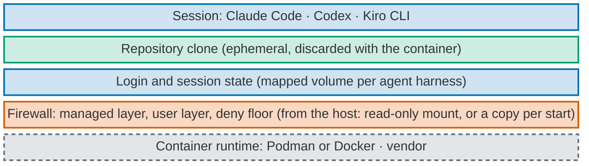
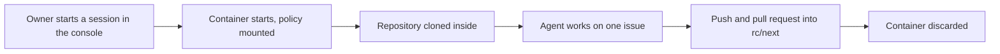

# Agent runtime: Product Requirements Document (container mode and web console)

Agent harness sessions that run either on the host or in a local container, orchestrated from a web
console on the owner's machine, and shaped so the same setup can later move to the cloud.

- **Status:** agreed with the owner in an interview on 2026-11-01. Items under
  [Open decisions](#8-open-decisions) are not decided.
- **Source:** [#78](https://github.com/tedeuxx/mhw/issues/78) (optional container mode) and
  [#79](https://github.com/tedeuxx/mhw/issues/79) (agent runtime of local containers, cloud-ready,
  orchestrated from a web console), and the owner interview of 2026-11-01.
- **How to read it:** this document states the target behaviour and why. Each decision carries the
  owner's words, translated to English, beside it. The order of the work will live in Issues, and the
  decision records owed by the build are named in [section 9](#9-decision-records-owed-by-the-build).
- **Parent document:** [the project requirements document](mhw-product-requirements-document-project.md).
  Nothing here weakens the personal policy floor it describes.

## Evidence level

**Everything in this document is *written*. Nothing is built, installed, loaded or enforced.** Where a
statement rests on a measurement, a vendor document or an assumption, it says which. No container
image, launcher or console exists in this repository today.

## 1. Problem

- Agent harness sessions run today as plain terminal processes on the owner's machine, under his user.
  Each slice is isolated only by a git worktree
  ([#216](https://github.com/tedeuxx/mhw/issues/216)): one issue, one worktree.
- A session can read and write anything his user can, including other repositories and the home
  directory. Only the deny floor and each agent harness's own permission prompts stand in the way.
- Running several sessions in parallel means several terminals, each tracked by hand.
- Nothing in the current setup can move to a cloud host: it is the configuration of one Mac.

## 2. What the agent harnesses offer natively

From [the native enforcement matrix](native-enforcement-matrix.md), section *Sandbox and container
support, for #78*, re-read for this document:

| Agent harness | Native isolation | Evidence |
| --- | --- | --- |
| Claude Code | OS-level sandbox (Seatbelt on macOS, bubblewrap on Linux) and a vendor reference dev container | documented |
| Codex | OS-level sandbox; read-only mode refused a write, workspace mode also opened temporary directories | measured (0.160.0) |
| Kiro CLI | no local sandbox; sandboxed execution only for cloud sessions | documented |

**No agent harness runs a session in Podman or Docker natively.** A container mode is therefore a
launcher this repository would write. The native sandboxes stay available and are not replaced: they
work inside the process, the container works around it.

On the reference machine, Podman (5.7.1) and Podman Desktop are installed; Docker is not (checked
2026-11-01 with `podman --version` and `which docker`).

## 3. Goals

The owner's answer to *what is the container for*, translated: **"all three"**.

1. **Isolate the host.** A session sees only its own container, the mapped login state and the policy
   mounted read-only, never the rest of the home directory.
2. **Cloud portability.** The container definition and the console are shaped so that phase 2 can run
   the same sessions on a cloud host.
3. **Parallel sessions.** Several sessions run at once, each in its own container, each on one issue.

Scope of version 1: the owner chose **container mode and the web console together**, over a container
mode alone first and over relying on the native sandboxes only.

## 4. Target behaviour: container mode (#78)

### 4.1 One switch per session

- A session starts in one of three modes: **host** (today's behaviour, stays available), **Podman** or
  **Docker**. Podman Desktop and Docker Desktop are both valid runtimes (owner, 2026-10-05, on #78:
  "leave Docker Desktop support as another valid option").
- **One runtime-neutral container definition** serves both runtimes. Any difference between them is
  stated where it applies, never hidden.
- **Base image:** the owner chose **an official Linux image, pinned by digest, rebuilt weekly** so it
  picks up agent harness updates. The pin makes each build reproducible; the weekly rebuild is what
  moves it forward.
- **Parallel ceiling:** the owner chose **a configurable ceiling, default 3**, held in the overlay. The
  console refuses to start a session beyond it.

### 4.2 Agent harnesses in the container

- **All three command-line agent harnesses** in version 1: Claude Code, Codex and Kiro CLI, on Linux,
  each able to run headless.
- **Kiro CLI login inside a container is not measured.** It is an open item to measure before Kiro is
  declared supported in container mode ([section 8](#8-open-decisions)).

### 4.3 What persists and what is ephemeral

Owner, translated: *"For authentication, cookies and session, mapping a volume makes sense. Git and
the rest must be ephemeral inside the container; that is one of the advantages."*

- **Persisted, in mapped volumes:** each agent harness's login and session state, and the GitHub CLI's
  login. One volume per agent harness, so a fresh container does not ask for a new login.
- **Ephemeral:** the repository is **cloned fresh inside each container** and discarded with it, along
  with every other file the session writes.
- **Work leaves the container only by `git push`.** A session that did not push left nothing behind.
- **Claude Code on macOS keeps its login in the Keychain**, which a Linux container cannot read. That
  storage is *documented* by the vendor; that the container cannot read it is *assumed* from how the
  two operating systems work; neither is *measured* here. The consequence is that Claude Code logs in
  once inside the container, and that login lives in its mapped volume.

### 4.4 The firewall inside the container

The owner chose **to mount the firewall from the host, read-only**, rather than to build it into the
image: a policy change on the host reaches the next container with no image rebuild.

- The mounted layers are the ones this repository renders today: the managed (admin) layer, the user
  layer with the deny floor, and the global brief.
- **The macOS admin paths do not exist in Linux.** The mount must place the admin layer where each
  agent harness reads it on Linux (`/etc/claude-code/` and `/etc/kiro/` are documented; Codex read
  `/etc/codex/` on this machine, measured by the 2026-10-04 canary). Where a layer cannot be placed,
  the gap is stated, never assumed covered.
- **Where the policy and the login share a directory, the policy is copied, not mounted.** On Linux,
  Claude Code keeps both its settings and its login under one user directory, so a read-only policy
  mount and a writable login volume would sit on the same path. The owner chose **to copy the host
  policy into the login volume at each container start**.
- **What the copy costs, stated plainly:** **the copy is writable, so an agent inside the container can
  alter it for that container's life.** The next container start copies the host policy again, so the
  change does not outlive the container, but while it runs the policy in that directory is only as
  strong as the agent's restraint.
- **This is in tension with the read-only mount above, and the tension is named, not resolved.** The
  mount decision was chosen so a session cannot change its own policy; the copy reopens that for the
  layers that live in the shared directory. Which layers are copied and which stay mounted read-only is
  stated per agent harness when it is built.
- **What the host mount costs, stated plainly:** the container is coupled to the host it runs on. **This choice
  does not carry to the cloud**: a cloud host has no owner's Mac to mount from. How the firewall layers
  reach a cloud runtime is an open decision for phase 2.

### 4.5 Network

The owner chose **open egress, as on the host today**.

- **What it costs, stated plainly:** **the container does not guard against exfiltration.** A session
  inside it can send anything it can read to any address, exactly as a host session can. The container
  isolates the host's files from the session; it does not isolate the internet from the session's
  content.
- The content controls stay what they are on the host: the paste cleaning (where it applies) and the
  outbound scan (`mhw scan`) before every push and pull request.

### 4.6 Layer view

*Read bottom-up. Grey dashed: vendor. Orange: administrator only. Blue: machine user. Green: project
contributors.*

## 5. Target behaviour: the web console (#79)

### 5.1 Access

- The owner chose **localhost only**: the console listens on `127.0.0.1` and has **no login of its own
  in version 1**. Reaching the loopback interface is enough to observe and to start or stop sessions.
- **Every merge or approve action needs a passkey (WebAuthn, Touch ID).** The owner chose this so that
  a process on the host, including a host-mode agent session, cannot perform those actions by reaching
  the console. Other console actions need no extra step.
- Hosting the console in the cloud is phase 2, and it will need its own authentication then.

### 5.2 What it does

The owner chose **full orchestration** in version 1:

- **Observe:** list running sessions, their mode, issue, branch and state.
- **Session lifecycle:** start a session (host, Podman or Docker) on an issue, stop it, remove its
  container.
- **Trigger the drain:** start the loop's autonomous drain over the ready queue.
- **Approve gates:** give the approvals that are the owner's, such as a high-risk PROD deployment under
  [ADR-0015](adr/0015-master-of-first-principles-ethical-locks-on-own-aims.md).
- **Merge:** the owner's merge act, under the rules in [section 6](#6-the-console-and-the-delivery-contract).
- **Open a terminal:** the owner, translated: *"it also needs a TTY session with the container, I think
  from the console."* The console opens an interactive terminal (TTY) attached to a running session's
  container.
- **Paste into that terminal is cleaned in the console.** The owner chose that a paste runs through the
  shared detection engine (the one the paste wrapper uses) before it reaches the TTY.

### 5.3 Sequence: one session, end to end

## 6. The console and the delivery contract

**The console is an owner surface. It adds no new merge path for agents.**

- **Slices:** agents merge slices into `rc/next` only through the checked route
  (`python3 -B workspace/delivery.py merge --pr N`), with its checks, the review gate and, on harness
  paths, the `agents-lead` lens, exactly as [`AGENTS.md`](../AGENTS.md) states. A session running in a
  container follows the same route; the console does not shortcut it.
- **Release candidate:** `rc/next` → `main` merges only on the owner's explicit act. The console may be
  where he performs that act; it is still his act, taken by him at the console, and it goes through the
  same checked command and verifier.
- **No agent drives the console's owner actions.** No session, in a container or on the host, can merge
  or approve through the console: each such action needs the owner's passkey
  ([section 5.1](#51-access)), which no agent holds.
- **ADR-0015 holds unchanged:** recoverable work stays autonomous; a high-risk PROD change needs the
  owner's explicit approval for that exact change. An approve button is how he gives it, never a way
  around it.
- **No hook is added** for any of this. The workstation reserves hooks for existential risk.

## 7. Phase 2: the cloud, named but not designed

- The same container definition runs on a cloud host.
- The console moves off localhost and gains its own login.
- **The firewall layers need a new route**, because the host mount of
  [section 4.4](#44-the-firewall-inside-the-container) does not carry. This is open.

## 8. Open decisions

Nothing in the numbered list is decided. Each is written as open rather than guessed.

1. **How the firewall layers reach a cloud runtime in phase 2.** Version 1 mounts them from the host,
   which a cloud host cannot do. Candidates (built into the image, fetched at start from a release,
   another route) are for a later interview.
2. **Kiro CLI login inside a container.** To be measured: whether Kiro CLI can log in headless inside a
   Linux container, and whether that login survives in a mapped volume.
3. **The console's technology stack.** *A recommendation from the tech lead, not the owner's decision:*
   a small server in Python's standard library or in Node, talking to Podman and Docker through their
   command-line tools rather than a runtime-specific API, so one code path serves both runtimes, with a
   browser terminal for the TTY. Reasons: this repository already ships Python scripts and an npm
   package, so no new language enters; the runtime CLIs are the runtime-neutral surface. Cost: a CLI
   wrapper is slower and less structured than an API client.

### Settled after the first draft

Five points found while writing the first draft were put to the owner and settled on 2026-11-01 (also
posted on [#79](https://github.com/tedeuxx/mhw/issues/79)). Each is now stated in the section it
belongs to:

| Point | The owner's choice | Where |
| --- | --- | --- |
| Settings and login share one directory on Linux | Copy the host policy into the login volume at each container start; the copy is writable for that container's life | [4.4](#44-the-firewall-inside-the-container) |
| Host agents reaching the console's owner actions | A passkey (WebAuthn, Touch ID) per merge or approve action; other actions need no step | [5.1](#51-access) |
| Paste in the console's terminal | Cleaned in the console by the shared detection engine before it reaches the TTY | [5.2](#52-what-it-does) |
| Parallel sessions | A configurable ceiling, default 3, held in the overlay; the console refuses beyond it | [4.1](#41-one-switch-per-session) |
| Base image | An official Linux image pinned by digest, rebuilt weekly | [4.1](#41-one-switch-per-session) |

## 9. Decision records owed by the build

Each of these crosses the significance gate (a new tool class or dependency, or a cross-cutting
pattern) and is owed in the same pull request as the change it justifies:

- the container mode as a supported session mode, and the runtime-neutral definition;
- the read-only host mount as the route for the firewall layers in version 1, and the writable
  per-start copy where policy and login share a directory;
- the web console as an owner surface, and the per-action passkey that keeps agents off its owner
  actions.

## 10. Related

- [#216](https://github.com/tedeuxx/mhw/issues/216): one issue per worktree, the review gate serial.
  A container per session is the same isolation one level further out.
- [#193](https://github.com/tedeuxx/mhw/issues/193): binding green evidence to the checkout, runtime and
  preview under test. A container is a runtime that evidence would need to name.
- [ADR-0015](adr/0015-master-of-first-principles-ethical-locks-on-own-aims.md): autonomy inside
  recoverable work; owner approval for high-risk PROD.
- [The native enforcement matrix](native-enforcement-matrix.md): what each agent harness enforces
  natively, including the sandbox rows for #78 and #79.
