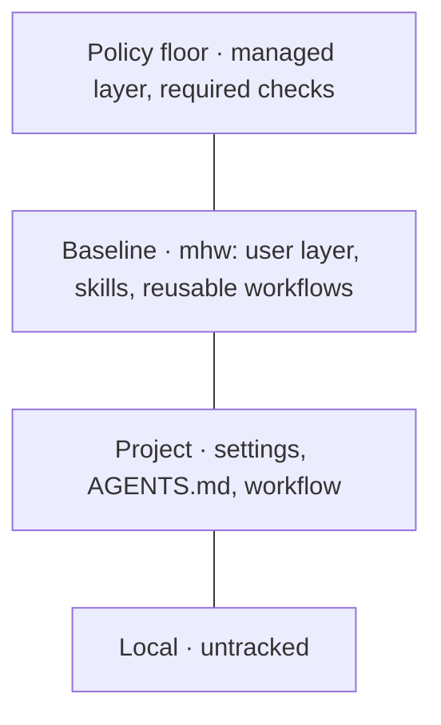

# CLI native baseline: Product Requirements Document (the mhw CLI only distributes)

The mhw command line distributes one baseline into each agent harness's native configuration on a
workstation. Every control it carries today moves to a native carrier: a harness rule or a CI/CD
pipeline.

- **Status:** agreed with the owner in a command-by-command interview on 2026-11-23. Items under
  [Open questions](#10-open-questions) are facts to measure, not decisions.
- **Source:** the owner's CLI review of 2026-11-23 (this session); the per-harness hook research of the
  same day (section 6). The owner's words are quoted in English translation from Portuguese.
- **Related:** [cloud environments](mhw-product-requirements-document-cloud-environments.md) (amended by
  section 7), [agent runtime](mhw-product-requirements-document-agent-runtime.md),
  [ADR-0033](adr/0033-paste-cleaning-wrapper-primary-hook-safety-net.md) (superseded in part, section 9).

## Evidence level

Three levels are used. The target behaviour is *written*: nothing is built. The per-harness hook facts
are *documented* (vendor pages, section 6), not measured. The inventory of today's commands is *read
from the source* of `rc/next` at `d42a900`.

## 1. Goal and scope

- **Goal:** *"a corporate-level order… for my own AI-native company. That is the goal."* The layered
  model a company uses (organisation policy, company baseline, project, local), applied to his own
  company.
- **Today's user:** *"today mhw focuses on the developer using agentic tools."*
- **Later:** *"in the future it may focus on administrative / knowledge workers using Claude Cowork, GPT
  work and Quick, in another category of AI software."* Those products have no terminal, so only native
  carriers can reach them; this document keeps that path open.

## 2. Principles the owner stated

1. **Native first.** *"Our whole purpose is to work with native mechanisms first, for compatibility and
   interoperability between harnesses."*
2. **Where controls live.** *"In general the controls are either in harness rules or in CI/CD
   pipelines."*
3. **No CLI in the runtime path.** *"It should be something installed once, and the runtime of each
   harness handles and executes the mechanism."*
4. **The CLI's one purpose.** *"The CLI has one single purpose: managing the multi-harness configuration
   on a workstation."* *"Its focus is distribution."*
5. **The finding behind it.** *"Too many harness features were wrongly implemented in the CLI layer."*

## 3. Baseline and override across projects

*"The idea is to have a baseline, extensible/override."* *"The baseline is what mhw manages."* Why:
*"so we avoid reconfiguring everything and not knowing any more how we work in each project."*

| Layer | What it holds | Who changes it | Native carrier |
| --- | --- | --- | --- |
| Policy floor | Deny floor, outbound checks, the delivery gates | The owner, as administrator | Harness managed layer; required checks |
| Baseline | Harness rules, skills, the method, reusable workflows | mhw, by release | Harness user layer; `uses: tedeuxx/mhw/...@vX` |
| Project | What a repository extends or overrides | The project | Project settings, `AGENTS.md`, its workflow |
| Local | One clone's adjustments, untracked | Nobody relaxes a protection there | Local settings |

A project extends or overrides the baseline. Nothing weakens the floor.



## 4. The CLI after the change

| Command | Purpose | Owner's call |
| --- | --- | --- |
| `install` (all current options) | Distribute the baseline; also renders the profile overlay and the Chrome debugging toggle | Keep; fix the `--method` help text (the plugin cutover is done) and show `--overlay` in the main help |
| `update` | Move to the newest or a named release | Keep |
| `uninstall` | Remove the baseline, restore replaced values | Keep |
| `status` (`--verbose`, `--summary`, `--project`) | Report what is distributed | Keep; show `--project` in the help; `--mcp-connect` moves out |
| `check` (`--prerequisites`, `--project`) | Exit non-zero on drift or a missing prerequisite | Keep |
| `mcp render`, `mcp launch`, **`mcp check`** | Distribute MCP servers; `mcp check` is today's connection test | Keep; *"MCP becomes its own command"*; the help must tell `mcp check` (connection) from `mcp render --check` (drift) |

Installation becomes one atomic command ([#584](https://github.com/tedeuxx/mhw/issues/584)), so
`postinstall` leaves too.

## 5. Where each removed command goes

| Today | Destination | Owner's words |
| --- | --- | --- |
| `scan` | A harness hook installed once, before every outbound act (push, pull request, publication); the detectors stay an internal engine; CI calls the engine directly; brief rule 8 is removed | *"You should not depend on calling the CLI to implement this mechanism."* |
| `add-term` and term lists | None: third-party terms are judged by the model (section 6) | *"I never thought of keeping this based on a list of values."* |
| `hook prompt` | Native hooks, with fallback (section 6) | *"I find it an antipattern given our strategy of native components."* |
| `paste-wrapper` | Removed; the hook on submit blocks and shows a redacted copy | Chose *"only hook on submit"* |
| `delivery merge\|verify` | GitHub rulesets require the checks and the quality-assurance verdict (as a status check) on `rc/next` and `main`; a skill conducts the flow | Chose *"GitHub + skill"*; *"it makes no sense not to be via harness"* |
| `delivery-gate` | A reusable GitHub Action each project references | *"It becomes a reusable GitHub Action."* |
| `policy check` | The `contract` step of that same Action | *"It goes in the same Action as delivery-gate."* |
| `docs-baseline check` | A step of the reusable workflow | applied by principle 4 |
| `milestone` | The skill calls `gh api` or the GitHub MCP; a native permission rule allows only the milestones endpoint, which closes today's hole in the deny floor | applied by principle 2 |
| `worklog` | Each harness's own usage data, recorded on the Issue; the event contract stays a JSON Schema | *"Every worklog should preferably be based on native harness components and recorded in the issue tracker."* |
| `launch-line` | `/handoff` uses each harness's native resume, or the skill writes the command | *"We should not depend on a CLI for this."* |
| `rite-cadence` | Rite dates read from the issue tracker by the skill | *"We should not depend on a CLI for this."* |
| `funnel-review` | The skill's instruction; each figure cites its source | applied by principle 5 |
| `onboard` | A method skill | applied by principle 4 |
| `profile`, `chrome-debugging` | Inside `install`, no separate command | applied by principle 4 |
| `install-user`, `install-admin`, `install-windows` | Internal, off the CLI surface | applied by principle 4 |

## 6. Outbound and prompt checks, per harness

Documented on 2026-11-23 (code.claude.com/docs/en/hooks, learn.chatgpt.com/docs/hooks,
kiro.dev/docs/hooks):

| | Claude Code | Codex 0.163 | Kiro CLI 3.1 / IDE |
| --- | --- | --- | --- |
| Command hook before the prompt, blocking | yes | yes | IDE yes; the CLI pages conflict, likely no |
| Command hook before a tool (`git push`), blocking | yes | yes | yes |
| Model-judged hook that blocks | yes (`type: prompt`) | no: parsed and skipped | no: "Agent Prompt" only adds context |
| Replace the prompt with a redacted copy | no, block and show | no, block | not confirmed |

The owner chose **native with fallback**:

- **Third-party terms** (employer, client, colleague, health): judged by the model through the brief and,
  on Claude Code, a `prompt`-type hook. Best effort: a term can pass, and a common word can be flagged.
- **Fixed-format patterns** (credentials, e-mail addresses, identity numbers): a small script installed
  as a file, no CLI subcommand, run by a command hook in all three harnesses, before the prompt and
  before `git push` / `gh pr create`.
- **Paste:** no cleaning at paste time; the hook on submit blocks and shows a redacted copy, and the
  owner resends it.

## 7. Consequences

- **One release removes every command at once** (owner's choice, *"all at once"*). It is a breaking
  change, so it is a major release (v11) under ADR-0002.
- **Superseded:** the cloud environments document's decision *"terms via variable"* (its §3 item 4 and §4
  first risk) has no object any more: no term list exists. That document is amended in the same build.
- **Without object:** [#563](https://github.com/tedeuxx/mhw/issues/563) (where term lists are stored) and
  [#583](https://github.com/tedeuxx/mhw/issues/583) (cloud term variables).
- **Hooks rule:** the outbound and prompt hooks fall under the workstation's one hook use, existential
  risk (a breach of third-party confidentiality).

## 8. SemVer normalisation (part of the same release)

The owner: *"also make the normalisation of the semver standard part of this version"*; *"we were
generating too many majors, it makes no sense. The current semver rule must have problems."*

**What the record shows** (read from the tracker on 2026-11-23): of 165 slices merged into `rc/next`, 11
carried `semver:major` (#90, #92, #95, #114, #199, #208, #214, #237, #423, #445, #525), and the release
candidate takes the largest label it contains, so one major slice made each release a major: v6.0.0 to
v10.0.0 in 20 days (2026-10-18 to 2026-11-07). Counted with:

```
gh pr list --repo tedeuxx/mhw --state merged --base rc/next --limit 400 --json number -q 'length'
gh pr list --repo tedeuxx/mhw --state merged --base rc/next --label semver:major --limit 400 --json number -q '[.[].number]'
for v in $(git tag -l 'v*.0.0' | sort -V); do echo "$v $(git log -1 --format=%cs $v)"; done
```

Most of the 11 were not changes to what a user installs or types: method skill renames and alias
removals (#199, #445, #525), a verdict literal (#423), internal control changes (#90, #92, #214, #237).
Three changed the install surface or what it grants (#95, #114, #208). The cut rule in
[ADR-0002](adr/0002-automatic-semver-cut-policy.md) (*"something that worked stops working the same way
for an existing user"*) was accepted on 2026-11-17; this document asks the owner to amend it.

**Decision (owner chose "public interface"):** mhw declares a public interface, and only a break of it is
a major.

| Part | Cut when |
| --- | --- |
| **major** | A break of the **public interface**: a command or option of the CLI in section 4 is removed or changes meaning, or the overlay schema the user writes becomes incompatible |
| **minor** | A new functionality, including a new control, skill or harness |
| **patch** | A fix, or an incremental change to something that exists: method, skills, briefs, controls, docs, tests, CI |

A control removed or weakened is minor or patch by this table; the release notes must say so. The
release that ships this document is the major (v11) that sets the new interface.

## 9. Decision records owed by the build

- Superseding ADR-0033: no paste wrapper; terms by model judgment; fixed patterns by an installed script.
- The delivery route on GitHub rulesets and a skill, replacing the checked merge command.
- The CLI's scope: distribution only.
- Amending ADR-0002 with the public-interface table, for the owner's ratification.

## 10. Open questions

1. Which usage data each harness exposes for the worklog (Claude Code, Codex, Kiro), to be verified per
   harness before the worklog slice.
2. Whether Kiro CLI's prompt-submit hook can block (the vendor pages conflict). To be measured.
3. How the quality-assurance verdict becomes a GitHub status check that a ruleset can require.
4. Which native carrier checks a publication made through the browser tool.
5. How the cloud environments document's `mhw cloud setup-script` and `mhw install --cloud` fit the
   six-command CLI of section 4. Both are distribution, so they fall inside the CLI's purpose; whether
   the setup script becomes an option of `install` or its own command is to be settled before that
   document's slices (#580, #581) are built.
