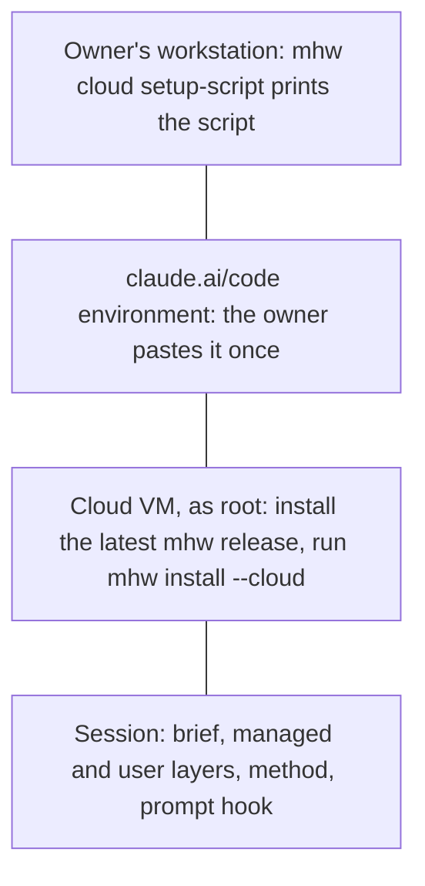

# Cloud environments: Product Requirements Document (mhw in Claude Code cloud sessions)

The same mhw experience in a Claude Code cloud session as on the reference workstation, with the
environment's setup produced by mhw itself.

- **Status:** agreed with the owner in an interview on 2026-11-23. Items under
  [Open questions](#7-open-questions) are facts to measure, not decisions.
- **Source:** [#561](https://github.com/tedeuxx/mhw/issues/561) and the owner interview of 2026-11-23.
- **Related:** [the agent runtime document](mhw-product-requirements-document-agent-runtime.md) leaves
  open how the firewall layers reach a cloud runtime (its open decision 1). This document answers that
  question for Claude Code cloud environments only. Nothing here weakens the personal policy floor.

## Evidence level

Everything in this document is *written*. One canary was *measured once* in one cloud session
(section 2). Nothing is built.

## 1. Problem

- A Claude Code cloud session runs in an Anthropic-managed VM, not on the owner's machine. The VM
  does not receive the workstation's user layer (`~/.claude`), its managed layer, or the paste wrapper.
- An environment (network level, environment variables, setup script) is created or edited only in the
  claude.ai/code UI. `/remote-env` only selects the default. No API is documented (*documented*,
  code.claude.com/docs/en/cloud-environments).
- So today a cloud session runs with only what the repository carries: no global brief, no deny floor,
  no prompt check.

Owner's objective: *"I want the same mhw experience as local in my cloud environment, and the setup
made easy by mhw itself."*

## 2. What the cloud loads (measured 2026-11-23)

The setup script runs as root on Ubuntu 24.04 before Claude Code starts (*documented*). A canary
setup script wrote three files; one session then reported:

| File written by the setup script | Loaded | Evidence |
| --- | --- | --- |
| `/root/.claude/CLAUDE.md` (brief marker) | yes | measured once |
| `/root/.claude/settings.json` (deny rule) | yes, the rule denied the command | measured once |
| `/etc/claude-code/managed-settings.json` (deny rule) | yes, the rule denied the command | measured once |
| Project `AGENTS.md` (from the clone) | yes | measured once |

The vendor page's "user settings are not read" means the local machine's file does not carry over; a
file written inside the VM is read. Not measured: whether a lower layer can override the managed deny.

## 3. Target behaviour

The cloud VM is treated as one more workstation. The setup script runs mhw's own installer there.

1. **`mhw cloud setup-script`** prints the setup script. It holds no secret and no term.
2. **The script installs the latest published mhw release** each time it runs (the environment caches it
   for about seven days and reruns it when the script changes). Owner: *"Always the latest."* A release
   exists only after the owner's go on the release candidate, so "latest" is never unreviewed work.
3. **`mhw install --cloud`** detects the VM (`CLAUDE_CODE_REMOTE=true`), installs the Claude Code
   parts (global brief, managed layer, user layer with deny floor, allow list and model defaults, the
   method, the prompt hook) and skips what does not exist there: the paste wrapper, Codex, Kiro,
   shell profile edits.
4. **The prompt hook checks the employer, client and colleague terms in the cloud too.** The salted term
   hashes and the salt reach the VM as environment variables of the environment, which the hook reads at
   session time. Owner chose this option (*"Terms via variable"*) over pattern-only checking, accepting
   the risk below.
5. **`mhw status`** run inside the session reports what is installed there, at its real evidence level.
6. **The owner pastes the script once per environment**, and the term variables when the list changes.
   `mhw cloud setup-script` prints the exact steps. That act is recorded as an `owner-action` Issue.

## 4. Accepted risks

- **The salt and the term hashes are readable by anyone who uses the environment** and are stored on
  the vendor's servers (*documented*: "Anyone who uses the environment can read the values"). The
  environment is personal; it must never be shared with a team. The plaintext terms never leave the
  workstation.
- **The cloud runs the latest release, which can be ahead of the workstation** until the owner installs
  it locally.
- **No paste wrapper on the web.** The prompt hook is the only mechanical check on a prompt.

## 5. Out of scope

- Creating or editing environments programmatically (no documented API).
- Codex, Kiro and other cloud surfaces.
- Secrets for services: they go in the environment's network secrets, never in mhw output.

## 6. Acceptance

- `mhw cloud setup-script` output, pasted into a fresh environment, yields a session where a canary
  shows the brief loaded, a deny-floor rule denied, and a synthetic term prompt blocked.
- `mhw install --cloud` is tested in a throwaway root on Linux, and exits cleanly where the paste
  wrapper, Codex or Kiro are absent.
- The script and `mhw status` never print a term, the salt or a secret value.

## 7. Open questions

1. Whether the default "Limited" network level reaches the GitHub release download, or the environment
   needs an allowed domain. To be measured in the first build.
2. Whether a user-layer rule can override a managed deny in the VM (the separation of the two layers).
3. The environment-variable size limit, against the size of the hashed term list.
4. Whether the setup script finishes inside the roughly five-minute cache threshold.
