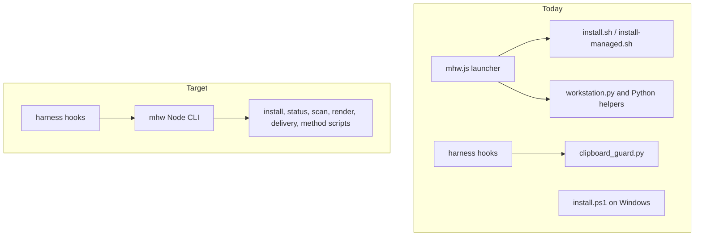

# mhw: one Node runtime — product requirements document

Status: **agreed on the goal, decisions D3–D11 taken by the agent and open to the owner's change.**
Issue: [#470](https://github.com/tedeuxx/mhw/issues/470). Interview of 2026-11-17, recorded verbatim at [the #470 interview comment](https://github.com/tedeuxx/mhw/issues/470#issuecomment-6956746151).

## The goal, in the owner's words

> "nao devemos trabalhar com nada alem de cli. shells devem ser refatorados para incorporarem a interface cli node."
>
> "mhw deveria ser um cli node que suporta a sua experiencia com os 3 harnesses"
>
> "nao queremos manter varios tipos de artefatos. devemos padronizar nosso runtime."
>
> "o meu problema é ter varios tipos de runtime" — "queremos uniformidade no tipo de solucao runtime"

In English:

- mhw is used through one interface, its CLI.
- `mhw` is a Node CLI that carries the agent harness experience on Claude Code, Codex and Kiro.
- **The problem to remove is several kinds of runtime.** The repository ends with one runtime, Node, and with
  no shell, PowerShell or Python code of its own.

## Why

Today `bin/mhw.js` is a thin launcher. On `origin/rc/next`, excluding tests, the logic lives in three other runtimes:

- six shell scripts, `global/install.sh` alone about 1,200 lines;
- one PowerShell installer, `global/install.ps1`;
- 31 Python files: `workstation.py`, the renderers, the clipboard guard and paste wrapper,
  ~~`workspace/delivery.py`~~ (moved to `src/commands/delivery.js` by S03, #474) and `method/scripts`.

Together with their tests that is about 37,000 lines. Each runtime brings its own prerequisites, test runner,
Windows behaviour and failure modes. A user needs Python 3.9+, a POSIX shell and Node, and Windows takes a
separate installer. One runtime means one prerequisite, one test runner and one installer for every
operating system.

## Decisions

| # | Decision | Settled by |
|---|---|---|
| D1 | **One runtime: Node.** Shell, PowerShell and Python are all migrated, tests included. No other language is kept. | Owner, 2026-11-17 (quoted above) |
| D2 | **Libraries may be used freely.** Exact versions in `package-lock.json`, `npm audit` in CI. This covers the two gaps Node's standard library leaves: a pty for the paste wrapper and a TOML parser for the Codex config. | Owner: "bibliotecas podem ser utilizadas sem problemas" (libraries can be used without problems). This replaces his earlier minimal-and-pinned answer ([interview comment](https://github.com/tedeuxx/mhw/issues/470#issuecomment-6956746151)). |
| D3 | **JavaScript ESM with JSDoc types, no build step.** The code that runs is the code in the repository. `tsc --noEmit` checks the types in CI, as a dev dependency and not a runtime. | Agent; open to the owner. Why: one artifact kind, and no `dist/`. |
| D4 | **Tests on the built-in `node:test` runner**, with the same throwaway-HOME probes the shell and Python suites use today. | Agent; open to the owner |
| D5 | **Migration one command at a time, with a parity test.** Each slice replaces one command or module, proves on a throwaway HOME that its output and file writes match the original, and then deletes the original in the same slice. The last slice adds a CI check that fails while any `.py`, `.sh` or `.ps1` file remains, except for vendored test fixtures. | Agent; open to the owner. Why: mhw keeps working at every merge, and each review stays small. |
| D6 | **Harness hooks call the CLI.** The prompt hook on Claude Code, Codex and Kiro becomes `mhw hook prompt --harness <h>` through Node. `node` must be on the hook environment's PATH, and `mhw status` names it when it is not. | Agent; open to the owner |
| D7 | **Windows through the same CLI.** `install.ps1` is retired once `mhw install` covers what it does. Whether the paste wrapper works on Windows through the pty library is *not measured*, and it stays a stated gap until measured. | Agent; open to the owner |
| D8 | **CI and release tooling on Node too.** `bump-my-version` (Python) is replaced by a Node equivalent or a small Node script that keeps the numeric SemVer cut policy (ADR-0002). SonarCloud stays: it is an external service, not a runtime of this repository. | Agent; open to the owner |
| D9 | **The method scripts distributed to projects** (`worklog`, `rite-cadence`, `funnel-review`, `milestone`, `launch-line` and their helpers `confine` and `milestone_common`) become Node and are run through the CLI. A consuming project then needs only Node. | Agent; open to the owner |
| D10 | **Order against the open backlog.** The first slice lands the CLI skeleton and the shared library (config read and write, rendering helpers, test harness). Issues #428–#443 are then built in Node on that base, not in the runtimes being retired. | Agent; open to the owner |
| D11 | **Node version floor:** the current LTS line at the time of the first slice, declared in `engines` and checked by `mhw status`. Today `engines` says `>=18`. | Agent; open to the owner |

## Acceptance at the end of the migration

- `git ls-files '*.py' '*.sh' '*.ps1'` returns nothing outside the declared fixtures, and a CI check keeps it so.
- `npm install -g` from the tagged GitHub archive (ADR-0034) is the only install route, on macOS, Linux and
  Windows. No Python is needed on the machine.
- Every command and hook that exists today still exists under `mhw`, with a parity test recorded in the
  slice that moved it.
- An ADR records the runtime change. It amends ADR-0034 (distribution), ADR-0025 (hook layers) and ADR-0033
  (paste wrapper).

Evidence level of this document: *written*. Nothing here is built, installed or measured.

## Open

- D3–D11 stand until the owner changes one. Each is reversible before its slice merges.
- The slice cut and its order come next, in `prd-to-issues`, after this document is agreed.
